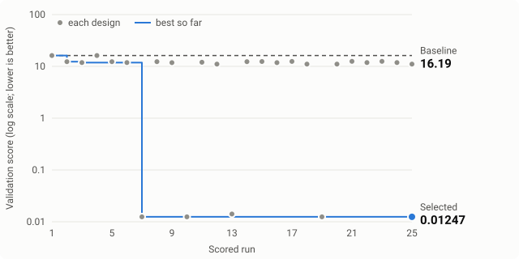
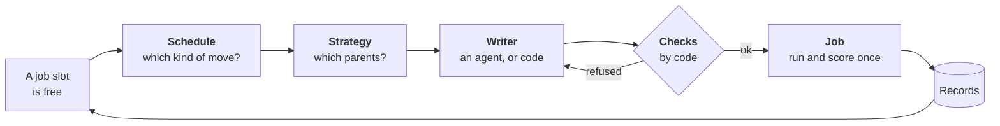

# evoloop

[](https://evoloop.readthedocs.io/en/latest/)

**Optimize the parts of your code you choose.**

Mark the code that may change and supply a scoring function. Agents propose code edits, or a built-in
optimizer tunes fixed settings. evoloop evaluates the variants within your budget, and records every
decision so you can steer the search while it runs.

<p align="center">
  <picture>
    <source media="(prefers-color-scheme: dark)" srcset="docs/assets/demo-dark.svg">
    
  </picture>
</p>
<p align="center"><sub>The CPU demo, fitting a formula to data on a budget of 24 evaluations. Scripted proposals stand in for a model here: this shows the machinery, not what an agent can find.</sub></p>

**[Documentation](https://evoloop.readthedocs.io)** · **[Run the CPU demo](#run-the-cpu-demo)** · **[Use your own project](#use-your-own-project)** · **[Status](#status)**

## Run the CPU demo

No API key, no GPU, under a minute. In a fresh Python environment (3.9 or later):

```
git clone https://github.com/cameo-db/evoloop.git
cd evoloop
python -m pip install -e . numpy

evoloop example demo                        # copies the example to ./demo
evoloop plan demo                           # what the search will do, the warnings, every setting
evoloop brief demo --confirm "Your Name"    # your agreement to the plan
evoloop run demo --name first
evoloop report demo --name first
```

Install from this repository: the package named `evoloop` on PyPI is a different project.
[What you should see](https://evoloop.readthedocs.io/en/latest/quickstart/).

## Use your own project

```
evoloop init mysearch --source path/to/project
```

1. **Mark the code** that may change, in the copy under `mysearch/base/`:
   `# EVOLVE-BLOCK-START name=trunk kind=structure role=trunk` ... `# EVOLVE-BLOCK-END`.
   Everything else is frozen, and your original project is never touched.
2. **Write the evaluator**, `mysearch/adapter/run.py`: it runs one design and writes a `result.json`
   with its score.
3. **Answer the questions** with `evoloop setup mysearch`: one at a time, with choices and a suggested
   answer where there is evidence for one.
4. **Read the plan, then confirm.** `evoloop plan mysearch` leads with what the search will actually
   do: who writes the designs, which agent roles run, how designs are selected, and what it will cost.
5. **Run**: `evoloop run mysearch --name r1`, on your machine or as one Slurm job per design.

[The full walk-through](https://evoloop.readthedocs.io/en/latest/setting-up/).

## What do you want to optimize?

Each goal is a different search. Its guide gives a starting configuration, why it fits, what your
evaluator must report, and how to read the result.

| I want to | Guide |
|---|---|
| tune hyperparameters, with no agent calls | [`settings-tuning`](https://evoloop.readthedocs.io/en/latest/guides/settings-tuning/) |
| improve a model's score | [`model-performance`](https://evoloop.readthedocs.io/en/latest/guides/model-performance/) |
| train a fixed architecture better | [`model-training-recipe`](https://evoloop.readthedocs.io/en/latest/guides/model-training-recipe/) |
| find one smaller or faster model | [`model-efficiency`](https://evoloop.readthedocs.io/en/latest/guides/model-efficiency/) |
| find the best model at several sizes | [`model-size-frontier`](https://evoloop.readthedocs.io/en/latest/guides/model-size-frontier/) |
| distil a student from a teacher | [`model-distillation`](https://evoloop.readthedocs.io/en/latest/guides/model-distillation/) |
| find models that fail differently, for an ensemble | [`model-ensemble-members`](https://evoloop.readthedocs.io/en/latest/guides/model-ensemble-members/) |
| adapt a pretrained model | [`model-finetuning`](https://evoloop.readthedocs.io/en/latest/guides/model-finetuning/) |
| improve an interpretable or biophysical model | [`model-mechanistic`](https://evoloop.readthedocs.io/en/latest/guides/model-mechanistic/) |
| make an algorithm faster | [`algorithm-runtime`](https://evoloop.readthedocs.io/en/latest/guides/algorithm-runtime/) |
| improve a bioinformatics method | [`bioinformatics-algorithm`](https://evoloop.readthedocs.io/en/latest/guides/bioinformatics-algorithm/) |
| make a data pipeline faster or cheaper | [`data-pipeline`](https://evoloop.readthedocs.io/en/latest/guides/data-pipeline/) |

Each of these is a *skill*: one editable file of settings and guidance for the agents. Your search
gets its own copy to change, skills can be combined, and you can write your own
([Skills](docs/skills.md)).

## How a search runs



- **Agents write and judge; code decides and records.** The budget, the limits and the frozen code
  are enforced by code, never by a prompt.
- **Built for costly, noisy evaluations.** Tens to hundreds of training runs, not millions of cheap
  tests: you state the noise floor, and a difference below it counts as no difference.
- **Steerable.** Almost every setting can change during a run. Each change is recorded with who made
  it, and scores from before and after a change that alters their meaning are never mixed.

## Steering while it runs

```
evoloop status mysearch --name r1
evoloop set    mysearch --name r1 schedule.novelty=0.6 budget.evaluations=300 --by "Your Name"
evoloop note   mysearch --name r1 "No attention layers." --roles writer --by "Your Name"
evoloop steer  mysearch --name r1 "more novelty from here, and keep models small" --by "Your Name"
evoloop chat   mysearch --name r1 --by "Your Name"      # talk to the agent that runs the search
evoloop stop   mysearch --name r1 --by "Your Name"
```

<details>
<summary><b>Everything you can choose</b></summary>

| For | You choose |
|---|---|
| **The goal** | a skill from the library, several combined, or your own |
| **How to search** | a run type: `explore_then_exploit`, `refine`, `survey`, `discovery`, `settings_only`, `custom` |
| **Selection** | families kept alive side by side (`lineage`), the best of each kind on a grid (`archive`), a tournament among recent designs (`tournament`), a trade-off front on two figures (`pareto`), or the best so far (`greedy`); on islands if wanted, with resets |
| **Exploration** | the shares of new designs, crossover and local moves by phase of the budget; a novelty dial; diversity by family and size or by what the trained model does |
| **What may change** | settings only, one module, the architecture, the architecture and the training recipe, or your own list |
| **Cost of an evaluation** | weak designs stopped early by a screen or a promotion ladder; a child trained from scratch or from its parent's weights |
| **The writers** | which Claude model and effort for each role; several models by share; whole blocks or find-and-replace edits |
| **Who decides** | code alone (deterministic), a strategist agent that may shift the course within bounds you set, or an agent that runs the search and that you talk to |
| **Oversight** | caps on evaluations and on model dollars; hard limits on size or speed; a scorecard of every agent |

[How each choice changes the search](docs/choices.md) · [Menu of choices and presets](docs/menu.md)

</details>

<details>
<summary><b>Where the mechanisms come from</b></summary>

| From | Taken |
|---|---|
| FunSearch | marked regions of a program; islands with resets; designs kept apart by what they do |
| AlphaEvolve | an archive on islands; a fast and a strong model writing together; edits as diffs; an evaluation cascade; several objectives; instructions that evolve |
| Regularized evolution | tournament selection with aging |
| MAP-Elites | the best of each kind, on a grid |
| NEAT | new families protected while young |
| Successive halving, ASHA | weak runs stopped early by rank |
| TPE (Optuna, Hyperopt) | Bayesian choice of settings |

evoloop adds steering through a recorded ledger, comparison periods that keep unlike scores apart, a
stated noise floor, skills, and an audit of the agents.
[How it compares](docs/compared.md), including where it falls short.

</details>

<details>
<summary><b>What a search leaves behind</b></summary>

- A leaderboard and a report: the best designs beside the baseline, with how each score was reached.
- Every design, with its code, where it came from, what its writer predicted and how it ended.
- A ledger of every change to the search, by whom, at how many evaluations.
- A scorecard of the agents: what each cost and whether its forecasts held.
- A study file in the CAMEO entry format.

[Records and the study file](docs/records.md)

</details>

## Status

Version 0.2. It passes its tests on the built-in demo with scripted proposals, and has run that demo on
a Slurm cluster. **It has not yet been run with a real model on a real training task**, and no
comparison of its search settings has been made. The guides give reasoned starting points, not measured
ones. [Status and limits](docs/status.md) says exactly what has been run.

## Documentation

<https://evoloop.readthedocs.io>

| | |
|---|---|
| Get started | [Run the CPU demo](docs/quickstart.md) · [Use your own project](docs/setting-up.md) · [The evaluator contract](docs/project-contract.md) |
| Understand | [How a search works](docs/how-it-works.md) · [How each choice changes the search](docs/choices.md) · [Skills](docs/skills.md) |
| Run and review | [Steering a run](docs/steering.md) · [Records](docs/records.md) · [Auditing the agents](docs/auditing.md) |
| Reference | [Commands](docs/commands.md) · [Fields of the brief](docs/fields.md) · [Skill library](docs/skill-library.md) |
| For an agent helping someone | [AGENTS.md](AGENTS.md) |

## Development

```
python -m pip install -e ".[test]"
pytest tests        # a few minutes on eight cores
```

MIT License. Copyright (c) 2026 Peter Koo.
