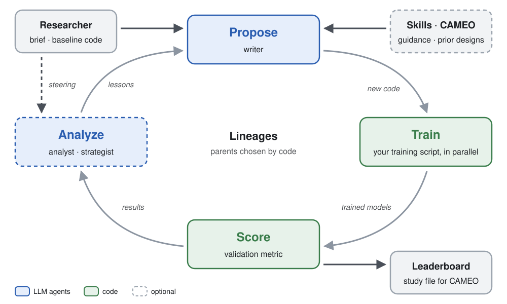
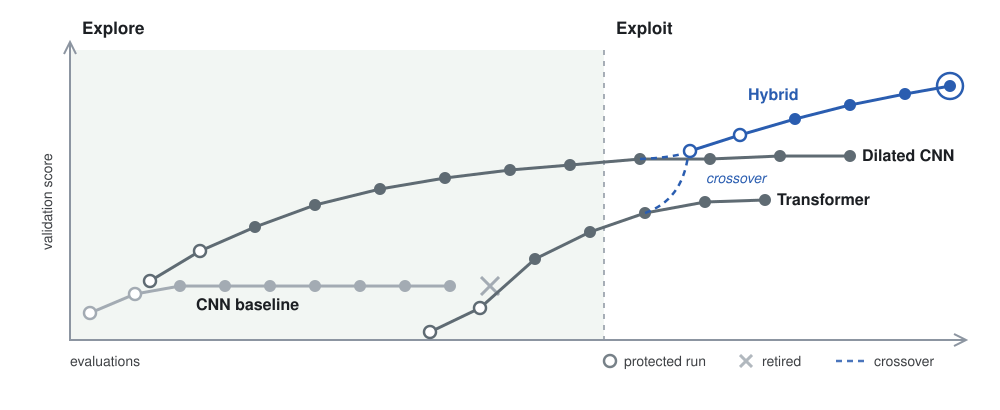

<p align="center">
  <picture>
    <source media="(prefers-color-scheme: dark)" srcset="docs/assets/evoloop-logo-dark.png">
    
  </picture>
</p>

[](https://evoloop.readthedocs.io/en/latest/)

**evoloop is an open-source, general-purpose AutoResearch loop driven by AI agents.** You give it code
and a way to score that code. AI agents propose changes, every change is evaluated automatically, and
the results decide what is tried next. A search runs for hundreds of experiments and keeps a record of
every one. It is MIT licensed.

It was built for machine-learning research, where it searches for better architectures, tunes training
recipes, distils large models into smaller ones, and maps the trade-off between accuracy and size. The
same loop works on any code that a script can score, such as an algorithm or a data pipeline.

You stay in charge of a search. You decide what may change and how much may be spent, you approve the
plan before anything runs, and you can redirect the search while it is running.

Documentation: <https://evoloop.readthedocs.io>

## How it works

You mark the parts of your code that may change and provide an *evaluator*: a script that runs one
version of the code and reports its score. For a model, the marked parts might be the architecture, the
loss or the training recipe, and the evaluator trains the model and reports its validation score.
evoloop then runs an evolutionary search over the marked parts.

<p align="center"></p>

A search repeats four steps until its budget of training runs is spent. The *writer* agent proposes a
design: an edit to a parent, a crossover of two parents, or something new. The evaluator trains it as
a job on your GPUs, alongside others. The design is scored on your validation metric and ranked. Every
few designs the *analyst* agent summarizes what has and has not worked, and the writer reads those
lessons before its next proposal. A *strategist* agent can shift effort between new designs and
refinement.

The agents propose and advise. Everything else is deterministic code: choosing which designs become
parents, rejecting any proposal that edits code you did not mark, stopping weak training runs early,
keeping test-set results away from the agents, and enforcing the budget. The method follows FunSearch
and AlphaEvolve, adapted to searches in which every evaluation is a full training run and the
researcher wants to steer.

By default the search keeps several lineages, families of designs descended from one founding design,
so that it does not converge on the first idea that works.

<p align="center"></p>

Lineages are one of five selection strategies. The others are a MAP-Elites archive, tournament
selection as in regularized evolution, a Pareto front over the score and a second measure such as model
size, and greedy hill climbing. Any of them can run as islands, as in FunSearch.

One setting controls how much the agents decide. At one end the controller plans every step and the
agents only write code. At the other, agents also choose what kind of change to make and adjust the
schedule. At every level the controller holds the budget, your limits, and the rule that only marked
code can change.

[How it works](https://evoloop.readthedocs.io/en/latest/how-it-works/) ·
[Parent selection](https://evoloop.readthedocs.io/en/latest/parents/) ·
[Agents](https://evoloop.readthedocs.io/en/latest/agents/)

## Get started

The way to use evoloop is through a coding agent. You say what you want to improve, the agent sets the
search up with you, and nothing is spent until you approve a plan. You do not need to read the code or
learn the commands.

Clone evoloop and open it in [Claude Code](https://claude.com/claude-code):

```
git clone https://github.com/cameo-db/evoloop.git
cd evoloop
claude
```

Then say what you want, in your own words. For example:

> Set up an evoloop search for my project in ~/projects/mymodel. I want a higher validation accuracy
> without making the model larger.

The agent follows [AGENTS.md](AGENTS.md). It asks you what to optimize, what may change, how a version
is scored, how much to spend and whether there are hard limits. It marks the code, writes the
evaluator, proves the setup with a dry run, and shows you the plan. After you approve, it starts the
search, watches it, and turns your feedback into changes to the running search.

You need an Anthropic API key or a Claude Code login for the agents, and a workstation or a Slurm
cluster to run on. Install from this repository; the package named `evoloop` on PyPI is a different
project.

To watch a search run first, the built-in example trains small classifiers on a toy dataset in about
half a minute, with no API key and no GPU:

```
python -m pip install -e . numpy
evoloop example demo
evoloop brief demo --confirm "Your Name"
evoloop run demo --name first
evoloop leaderboard demo --name first
```

Everything the agent does is a command or a plain file, and can be done by hand.
[Get started](https://evoloop.readthedocs.io/en/latest/get-started/) ·
[Manual setup](https://evoloop.readthedocs.io/en/latest/setting-up/) ·
[Monitor and steer a search](https://evoloop.readthedocs.io/en/latest/steering/)

## Skills

A skill is a file of search settings and agent guidance for one goal. evoloop runs without one. With
one, you supply less yourself. The one you choose is copied into your search folder, where you can edit
it, and several can be merged into one file.

| Skill | Goal |
|---|---|
| [`model-performance`](evoloop/skills/model-performance/skill.yaml) | improve a model's score, with the architecture open |
| [`model-training-recipe`](evoloop/skills/model-training-recipe/skill.yaml) | train a fixed architecture better: loss, optimizer, schedule, augmentation |
| [`settings-tuning`](evoloop/skills/settings-tuning/skill.yaml) | tune hyperparameters, with an agent choosing each trial |
| [`settings-tuning-bayesian`](evoloop/skills/settings-tuning-bayesian/skill.yaml) | tune hyperparameters with a Bayesian optimizer and no agent |
| [`model-finetuning`](evoloop/skills/model-finetuning/skill.yaml) | adapt a pretrained model |
| [`model-efficiency`](evoloop/skills/model-efficiency/skill.yaml) | shrink a model by distilling it into a cheaper student |
| [`model-distillation`](evoloop/skills/model-distillation/skill.yaml) | distil an ensemble or a larger model into a student |
| [`model-size-frontier`](evoloop/skills/model-size-frontier/skill.yaml) | find the best model at each of several sizes |
| [`model-ensemble-members`](evoloop/skills/model-ensemble-members/skill.yaml) | find good models that fail differently |
| [`model-mechanistic`](evoloop/skills/model-mechanistic/skill.yaml) | improve an interpretable or biophysical model |
| [`algorithm-runtime`](evoloop/skills/algorithm-runtime/skill.yaml) | make an algorithm faster with the same output |
| [`bioinformatics-algorithm`](evoloop/skills/bioinformatics-algorithm/skill.yaml) | improve a bioinformatics method against a truth set |
| [`data-pipeline`](evoloop/skills/data-pipeline/skill.yaml) | make a data pipeline faster or cheaper |

[Choose a skill](https://evoloop.readthedocs.io/en/latest/which-search/) ·
[Edit or merge a skill](https://evoloop.readthedocs.io/en/latest/skills/) · [Write a skill](https://evoloop.readthedocs.io/en/latest/custom-skills/)

## CAMEO

[CAMEO](https://cameo-db.github.io) is a public database of trained models with their code and
scores. A search can start from designs in CAMEO (`evoloop import --from-study`), and every search is
saved as `study.json` in CAMEO's format so that it can be deposited there.

[Start from earlier designs](https://evoloop.readthedocs.io/en/latest/warm-start/) ·
[Save and deposit the study](https://evoloop.readthedocs.io/en/latest/study/)

## Disclaimer

Every AutoResearch method is a search, and how a search is run changes what it finds. No strategy,
preset or custom configuration is guaranteed to find the best design. evoloop is infrastructure for
running different kinds of search and recording what each one did. The agents add variability of
their own: an LLM does not return the same proposal twice, so two runs of the same search can end in
different places. Treat the result of a search as a candidate, and check it on held-out data.
[Limitations](https://evoloop.readthedocs.io/en/latest/limitations/)

## Development

```
python -m pip install -e ".[test]"
pytest tests
```

MIT License. Copyright (c) 2026 Peter Koo.
