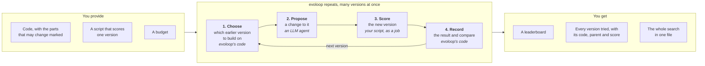

<p align="center">
  <picture>
    <source media="(prefers-color-scheme: dark)" srcset="docs/assets/evoloop-logo-dark.png">
    
  </picture>
</p>

[](https://evoloop.readthedocs.io/en/latest/)

**evoloop improves code you can score.** You mark the parts of your code that may change and write a
script that measures how good one version is. evoloop then runs an evolutionary search: LLM agents
propose changes, your script scores each one, and the results decide what is tried next.

Use it to raise a model's validation score, train a smaller student from a teacher, tune
hyperparameters, or make an algorithm or pipeline faster while its output stays the same.

Documentation: <https://evoloop.readthedocs.io>



Agents write the changes. Code does everything that must be trusted: it picks what to build on, checks
that only the marked parts changed, runs the jobs, enforces the budget and your limits, and keeps the
record.

> **Recommended: run it through [Claude Code](https://claude.com/claude-code).** Open this repository in Claude Code and
> say what you want to improve. It sets up the search with you by asking the questions one at a time, starts the run
> when you confirm the plan, and watches it: it reports progress, reads the results with you, and turns your feedback
> into changes to the running search.

## Three ways to run it

| | What you do |
|---|---|
| **Let an agent run it** | Open this repository in Claude Code or another coding agent and say what you want to improve. The agent asks you the setup questions one at a time, marks the code and writes the scoring script with you, shows you the plan, and starts the search when you confirm. It follows [AGENTS.md](AGENTS.md). |
| **Answer the questions yourself** | `evoloop setup` asks the same questions in the terminal; `evoloop form` gives them as a web page. |
| **Edit the files** | Everything is a plain file: the brief (`brief.yaml`), the task description the agents read, and the skill files. |

Every search starts the same way: a short list of questions, a plan that states what will run and what
it is likely to cost, and your confirmation. Nothing is spent before you confirm.

It is a general search. Two things configure it: the search strategy and how much of the search agents
decide. An optional skill sets those choices for a particular goal and tells the agents how to approach
it.

## One iteration

| Step | What happens | Decided by | Code |
|---|---|---|---|
| 1 | Pick the kind of move: a new design, a crossover of two, or a local move on one (an edit, a hyperparameter change, an ablation) | the schedule, in code; optionally a coordinator agent | [`schedule.py`](evoloop/schedule.py) |
| 2 | Pick the parent design or designs | the search strategy, in code | [`strategies/`](evoloop/strategies) |
| 3 | Write the candidate: new contents for the marked blocks | a writer agent (LLM) | [`design.py`](evoloop/design.py), prompts in [`agents.py`](evoloop/agents.py) |
| 4 | Check it: only marked blocks changed, it parses, it is not a copy | code | [`space.py`](evoloop/space.py) |
| 5 | Run your evaluator on it as its own job, locally or on Slurm | your script | [`jobs.py`](evoloop/jobs.py) |
| 6 | Record the design, its parent, its score and the agent's forecast | code | [`store.py`](evoloop/store.py) |

## Search strategies

The strategy is the rule for step 2. Set it with `strategy.mechanism`.

| Strategy | Parents are chosen from | Method it follows | Code |
|---|---|---|---|
| `lineage` (default) | the best design of each of several families; new families get protected evaluations | speciation with protected niches, as in NEAT | [`lineage.py`](evoloop/strategies/lineage.py) |
| `archive` | the best design in each cell of a grid (family and size, or error pattern) | MAP-Elites; with islands, AlphaEvolve's program database | [`archive.py`](evoloop/strategies/archive.py) |
| `tournament` | the best of 3 drawn from the 24 most recent designs | regularized evolution (Real et al. 2019) | [`tournament.py`](evoloop/strategies/tournament.py) |
| `pareto` | designs not beaten on both the score and a second metric | non-dominated sorting, as in NSGA-II | [`pareto.py`](evoloop/strategies/pareto.py) |
| `greedy` | the single best design | hill climbing | [`greedy.py`](evoloop/strategies/greedy.py) |

Any strategy can run as separate populations that are restarted from the best one
(`strategy.islands`, `strategy.reset_every`), as in FunSearch.

| Other mechanism | Setting | Method it follows |
|---|---|---|
| Marked regions of a program evolved by an LLM | `EVOLVE-BLOCK` markers | FunSearch, AlphaEvolve |
| Stop weak candidates part way through training | `evaluation.ladder` | successive halving, ASHA |
| A cheap model for most candidates, a strong one for some | `agents.writer_mix` | AlphaEvolve |
| Candidates returned as diffs | `variation.edit_format: diff` | AlphaEvolve |
| Hyperparameters from a Bayesian optimizer, no agent | `variation.settings_by: tpe` | TPE (Optuna, Hyperopt) |

## Harness and autonomy

`harness.autonomy` sets how much the agents decide. More autonomy costs more LLM calls.

| | `harnessed` | `guided` | `agentic` |
|---|---|---|---|
| Kind of move for each slot | schedule (code) | schedule (code) | a coordinator agent |
| Parents | strategy (code) | strategy (code) | strategy (code) |
| Strategist agent that can shift the schedule | off | on, within limits | on, wider limits |
| Hyperparameter moves | random sampler (code) | writer agent | writer agent |
| LLM calls for 100 designs, estimated | about 110 | about 140 | about 270 |

Under every level, code enforces the budget, any limits you set, and the checks in step 4.

## Skills

Skills are optional. Without one, the settings come from the run type and the agents see only your task
description. A skill adapts the general search to one goal, so you supply less yourself. It is a YAML file with
settings for the choices above, text added to every agent call, and the measurements your evaluator
must report. You name it in the brief (`run.skill: model-efficiency`); evoloop copies the file into your
search folder when you choose it. You can edit the copy during setup, or merge several skills into one
file (`evoloop skills --merge`).

| Skill | Goal |
|---|---|
| [`model-performance`](evoloop/skills/model-performance/skill.yaml) | improve a model's score, with the architecture open |
| [`model-training-recipe`](evoloop/skills/model-training-recipe/skill.yaml) | train a fixed architecture better: loss, optimizer, schedule, augmentation |
| [`settings-tuning`](evoloop/skills/settings-tuning/skill.yaml) | tune hyperparameters, with an agent choosing each trial |
| [`settings-tuning-bayesian`](evoloop/skills/settings-tuning-bayesian/skill.yaml) | tune hyperparameters with a Bayesian optimizer and no agent |
| [`model-finetuning`](evoloop/skills/model-finetuning/skill.yaml) | adapt a pretrained model |
| [`model-efficiency`](evoloop/skills/model-efficiency/skill.yaml) | shrink a model by distilling it into a cheaper student |
| [`model-distillation`](evoloop/skills/model-distillation/skill.yaml) | distil an ensemble or a larger model into a student |
| [`model-size-frontier`](evoloop/skills/model-size-frontier/skill.yaml) | find the best model at each of several sizes |
| [`model-ensemble-members`](evoloop/skills/model-ensemble-members/skill.yaml) | find good models that fail differently |
| [`model-mechanistic`](evoloop/skills/model-mechanistic/skill.yaml) | improve an interpretable or biophysical model |
| [`algorithm-runtime`](evoloop/skills/algorithm-runtime/skill.yaml) | make an algorithm faster with the same output |
| [`bioinformatics-algorithm`](evoloop/skills/bioinformatics-algorithm/skill.yaml) | improve a bioinformatics method against a truth set |
| [`data-pipeline`](evoloop/skills/data-pipeline/skill.yaml) | make a data pipeline faster or cheaper |

The links open the files. The [documentation](https://evoloop.readthedocs.io/en/latest/which-search/)
has a page for each, showing what it sets and what it tells the agents.

## Use it on your project

```
git clone https://github.com/cameo-db/evoloop.git
cd evoloop
python -m pip install -e .

evoloop init mysearch --source path/to/project
```

Install from this repository. The package named `evoloop` on PyPI is a different project.

1. Mark the code that may change, in the copy under `mysearch/base/`, with a pair of comment lines:
   `# EVOLVE-BLOCK-START name=trunk kind=structure role=trunk` and `# EVOLVE-BLOCK-END`.
2. Write the scoring script, `mysearch/adapter/run.py`. It runs one design and writes a `result.json`
   with its score.
3. Answer the set-up questions: `evoloop setup mysearch`.
4. Read the plan, then confirm it: `evoloop plan mysearch`, then
   `evoloop brief mysearch --confirm "Your Name"`.
5. Run: `evoloop run mysearch --name r1`.

A coding agent can do this with you. Open this repository in Claude Code, or another agent that can read
files and run commands, and ask it to set up a search for your project; it follows [AGENTS.md](AGENTS.md).
You decide what to optimize, what may change, how a design is scored, how much to spend, and any hard
limits.

[Set up your search](https://evoloop.readthedocs.io/en/latest/setting-up/) ·
[Write the evaluator](https://evoloop.readthedocs.io/en/latest/evaluator/) ·
[Run on a cluster](https://evoloop.readthedocs.io/en/latest/servers/)

## Change a search while it runs

```
evoloop status mysearch --name r1
evoloop set    mysearch --name r1 schedule.novelty=0.6 budget.evaluations=300 --by "Your Name"
evoloop note   mysearch --name r1 "No attention layers." --roles writer --by "Your Name"
evoloop stop   mysearch --name r1 --by "Your Name"
evoloop run    mysearch --name r1            # resume
```

Each change is checked, applied from the next design on, and recorded with your name. The objective and
the scheduler are fixed when a search starts.
[Watch and steer a run](https://evoloop.readthedocs.io/en/latest/steering/).

## A worked example

The package carries a small search that runs on a laptop in half a minute, with no API key and no GPU.
It trains small classifiers on a toy dataset, each one for real.

```
python -m pip install -e . numpy
evoloop example demo
evoloop brief demo --confirm "Your Name"
evoloop run demo --name first
evoloop leaderboard demo --name first
```

<p align="center">
  <picture>
    <source media="(prefers-color-scheme: dark)" srcset="docs/assets/demo-dark.svg">
    
  </picture>
</p>

40 training runs across 39 designs take validation accuracy from 0.50 to 0.97. The proposals in the demo
are scripted, so it shows how a search proceeds and what it records, not what a language model would
find. [Run the demo](https://evoloop.readthedocs.io/en/latest/quickstart/) walks through the output.

## What a search leaves behind

A leaderboard and a report; every design with its code, its parent and its score; a ledger of every
change made during the search; a record of every agent call and what it cost; and `study.json`, the
whole search in one file in the format of [CAMEO](https://cameo-db.github.io), a public database of
models and how they were trained. [Save and deposit the study](docs/study.md).

## CAMEO: start from other searches, and add yours

evoloop reads and writes the CAMEO format.

- **In:** `evoloop import --from-study FILE` takes designs from a CAMEO study file. Designs from the same project
  are trained in your search. Designs from other data are shown to the agents as ideas to adapt.
- **Out:** every search writes `study.json`, ready to deposit in CAMEO.

[Start from earlier designs](docs/warm-start.md)

## Status

Version 0.2. It passes its tests on two built-in examples with scripted proposals standing in for a
language model, and has run one of them on a Slurm cluster. It has not yet been run with a real model
on a real training task, and its search settings have not been compared against each other.
[Status and limits](docs/status.md) lists what has been run.

## Documentation

| | |
|---|---|
| Start | [Run the demo](docs/quickstart.md) · [Set up your search](docs/setting-up.md) · [Write the evaluator](docs/evaluator.md) · [Measure your noise](docs/noise.md) · [Run on a cluster](docs/servers.md) |
| Choose a search | [Which search should I run?](docs/which-search.md) · [Edit, merge or write a skill](docs/skills.md) |
| Concepts | [One step of a search](docs/how-it-works.md) · [What gets tried next](docs/schedule.md) · [Who becomes a parent](docs/parents.md) · [Cheaper evaluations](docs/early-stopping.md) · [The agents](docs/agents.md) |
| Run and steer | [Watch and steer a run](docs/steering.md) · [Budget and cost](docs/cost.md) · [Save and deposit the study](docs/study.md) |
| Reference | [Commands](docs/commands.md) · [Brief fields](docs/fields.md) · [Evaluator interface](docs/project-contract.md) · [Glossary](docs/glossary.md) |

## Development

```
python -m pip install -e ".[test]"
pytest tests
```

MIT License. Copyright (c) 2026 Peter Koo.
