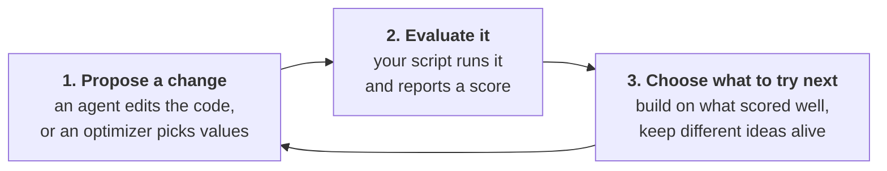

<p align="center">
  <picture>
    <source media="(prefers-color-scheme: dark)" srcset="docs/assets/evoloop-logo-dark.png">
    
  </picture>
</p>

[](https://evoloop.readthedocs.io/en/latest/)

**An optimization loop for models, algorithms, and data pipelines.**

Give evoloop working code and a way to score it. You choose which parts may change. AI agents propose
changes, evoloop evaluates each version, and the results guide what it tries next. For numerical
settings, a built-in optimizer can propose the changes with no agent at all.

Use it to improve a model's accuracy, find a smaller model at a similar score, tune a training recipe,
or make a pipeline faster while checking that its outputs stay correct.

Documentation: <https://evoloop.readthedocs.io>

## How it works



You mark the parts of your code that may change and write a script that scores one version. Everything
else is frozen. The loop then repeats until the budget you set is spent, and writes down every design,
score and decision as it goes.

| Stage | What happens | Who does it |
|---|---|---|
| Propose a change | a new design, an edit to an earlier one, a combination of two, or new values for the settings | an agent; or, for settings, a built-in Bayesian optimizer or sampler |
| Evaluate it | the design is checked, then run as its own job; your script writes its score | your code, on your machine or one Slurm job per design |
| Choose what to try next | which earlier designs get built on, and how much of the budget goes to new ideas | evoloop's code, from the scores |

An agent only ever returns text. evoloop's code decides what is tried next, enforces the budget and any
limits you set, and refuses a design that touches code outside the marked parts.

It is built for evaluations that are expensive and noisy, such as training runs: tens to hundreds of
them, where two runs of the same design give slightly different scores. You say how large that
variation is, and smaller differences are not counted as gains.

## What you choose

Two choices shape a search. Everything else has a default.

**The goal: what you want.** Each goal comes with a guide, settings that suit it, and advice for the
agents, all in a file you can edit.

| Goal | For |
|---|---|
| [`model-performance`](https://evoloop.readthedocs.io/en/latest/guides/model-performance/) | the best score, with the architecture open |
| [`model-training-recipe`](https://evoloop.readthedocs.io/en/latest/guides/model-training-recipe/) | a better score from the same architecture: the loss, optimizer, schedule, augmentation |
| [`settings-tuning`](https://evoloop.readthedocs.io/en/latest/guides/settings-tuning/) | hyperparameters only, by a Bayesian optimizer, with no agent calls |
| [`model-finetuning`](https://evoloop.readthedocs.io/en/latest/guides/model-finetuning/) | adapting a pretrained model |
| [`model-efficiency`](https://evoloop.readthedocs.io/en/latest/guides/model-efficiency/) | one smaller or faster model at about the same score |
| [`model-size-frontier`](https://evoloop.readthedocs.io/en/latest/guides/model-size-frontier/) | the best model at each of several sizes |
| [`model-distillation`](https://evoloop.readthedocs.io/en/latest/guides/model-distillation/) | a small student that matches a large teacher |
| [`model-ensemble-members`](https://evoloop.readthedocs.io/en/latest/guides/model-ensemble-members/) | several good models that fail differently |
| [`model-mechanistic`](https://evoloop.readthedocs.io/en/latest/guides/model-mechanistic/) | an interpretable or biophysical model, improved without losing its meaning |
| [`algorithm-runtime`](https://evoloop.readthedocs.io/en/latest/guides/algorithm-runtime/) | the same output from an algorithm, sooner |
| [`bioinformatics-algorithm`](https://evoloop.readthedocs.io/en/latest/guides/bioinformatics-algorithm/) | a bioinformatics method that is more accurate against a truth set |
| [`data-pipeline`](https://evoloop.readthedocs.io/en/latest/guides/data-pipeline/) | a data pipeline that is faster or cheaper, with its output checked |

Goals can be combined, and you can write your own.

**The run type: how the budget is spent.**

| Run type | Spends the budget on |
|---|---|
| `explore_then_exploit` | new ideas first, then improving the best of them (the default) |
| `refine` | improving a model that already works |
| `survey` | many different ideas, each kept in play |
| `discovery` | unusual designs, when evaluations are cheap |
| `settings_only` | numerical settings and nothing else |

[Which search should I run?](https://evoloop.readthedocs.io/en/latest/which-search/) puts a goal and a
run type together and shows the search that results.

Other things you can set, all with defaults and all changeable while a search runs:

| | Options |
|---|---|
| Which earlier designs get built on | several families side by side, the best of each kind, a tournament among recent designs, a trade-off front on two metrics, or always the current best |
| Stopping weak designs early | half of new designs stopped half way (the default), or a ladder of checks on every design |
| Who writes the designs | one Claude model or a mix; whole blocks or small edits |
| How much the agents decide | code runs the search and agents only write; or a strategist agent adjusts it within bounds; or an agent runs it and you talk to it |
| Limits | a cap on evaluations, a cap on agent dollars, hard bounds on model size or speed |

## Where the methods come from

evoloop combines mechanisms that others introduced. Each is an option.

| Mechanism | From | In evoloop |
|---|---|---|
| Evolve marked regions of a program with a language model | FunSearch, AlphaEvolve | `EVOLVE-BLOCK` markers; everything else frozen |
| Separate populations that are reset from the best | FunSearch | `strategy.islands`, `strategy.reset_every` |
| Keep the best of each kind of design | MAP-Elites, AlphaEvolve | `strategy.mechanism: archive` |
| A fast model and a strong model writing together | AlphaEvolve | `agents.writer_mix` |
| Edits returned as diffs | AlphaEvolve | `variation.edit_format: diff` |
| Tournament selection with aging | Regularized evolution | `strategy.mechanism: tournament` |
| New families protected while young | NEAT | `strategy.mechanism: lineage` (the default) |
| A trade-off front on two objectives | multi-objective evolution | `strategy.mechanism: pareto` |
| Stopping weak runs early by rank | successive halving, ASHA | `evaluation.ladder` |
| Bayesian choice of hyperparameters | TPE (Optuna, Hyperopt) | `variation.settings_by: tpe` |

What evoloop adds: every setting change during a search is recorded with who made it; scores from before
and after a change that alters their meaning are kept apart; and the goal is chosen separately from the
search method. [Compared with FunSearch and AlphaEvolve](docs/compared.md) covers each mechanism and
where evoloop falls short of them.

## Use it on your project

```
git clone https://github.com/cameo-db/evoloop.git
cd evoloop
python -m pip install -e .

evoloop init mysearch --source path/to/project
```

Install from this repository. The package named `evoloop` on PyPI is a different project.

1. Mark the code that may change, in the copy under `mysearch/base/`, with a pair of comment lines:
   `# EVOLVE-BLOCK-START name=trunk kind=structure role=trunk` and `# EVOLVE-BLOCK-END`.
2. Write the scoring script, `mysearch/adapter/run.py`. It runs one design and writes a `result.json`
   with its score.
3. Answer the set-up questions: `evoloop setup mysearch`.
4. Read the plan, then confirm it: `evoloop plan mysearch`, then
   `evoloop brief mysearch --confirm "Your Name"`.
5. Run: `evoloop run mysearch --name r1`.

A coding agent can do this with you. Open this repository in Claude Code, or another agent that can read
files and run commands, and ask it to set up a search for your project; it follows [AGENTS.md](AGENTS.md).
You decide what to optimize, what may change, how a design is scored, how much to spend, and any hard
limits.

[Set up your search](https://evoloop.readthedocs.io/en/latest/setting-up/) ·
[Write the evaluator](https://evoloop.readthedocs.io/en/latest/evaluator/) ·
[Run on a cluster](https://evoloop.readthedocs.io/en/latest/servers/)

## Change a search while it runs

```
evoloop status mysearch --name r1
evoloop set    mysearch --name r1 schedule.novelty=0.6 budget.evaluations=300 --by "Your Name"
evoloop note   mysearch --name r1 "No attention layers." --roles writer --by "Your Name"
evoloop stop   mysearch --name r1 --by "Your Name"
evoloop run    mysearch --name r1            # resume
```

Each change is checked, applied from the next design on, and recorded with your name. The objective and
the scheduler are fixed when a search starts.
[Watch and steer a run](https://evoloop.readthedocs.io/en/latest/steering/).

## A worked example

The package carries a small search that runs on a laptop in half a minute, with no API key and no GPU.
It trains small classifiers on a toy dataset, each one for real.

```
python -m pip install -e . numpy
evoloop example demo
evoloop brief demo --confirm "Your Name"
evoloop run demo --name first
evoloop leaderboard demo --name first
```

<p align="center">
  <picture>
    <source media="(prefers-color-scheme: dark)" srcset="docs/assets/demo-dark.svg">
    
  </picture>
</p>

40 training runs across 39 designs take validation accuracy from 0.50 to 0.97. The proposals in the demo
are scripted, so it shows how a search proceeds and what it records, not what a language model would
find. [Run the demo](https://evoloop.readthedocs.io/en/latest/quickstart/) walks through the output.

## What a search leaves behind

A leaderboard and a report; every design with its code, its parent and its score; a ledger of every
change made during the search; a record of every agent call and what it cost; and `study.json`, the
whole search in one file in the format of [CAMEO](https://cameo-db.github.io), a public database of
models and how they were trained. [Save and deposit the study](docs/study.md).

## Status

Version 0.2. It passes its tests on two built-in examples with scripted proposals standing in for a
language model, and has run one of them on a Slurm cluster. It has not yet been run with a real model
on a real training task, and its search settings have not been compared against each other.
[Status and limits](docs/status.md) lists what has been run.

## Documentation

| | |
|---|---|
| Start | [Run the demo](docs/quickstart.md) · [Set up your search](docs/setting-up.md) · [Write the evaluator](docs/evaluator.md) · [Measure your noise](docs/noise.md) · [Run on a cluster](docs/servers.md) |
| Choose a search | [Which search should I run?](docs/which-search.md) · [Edit or write a skill](docs/skills.md) |
| Concepts | [One step of a search](docs/how-it-works.md) · [What gets tried next](docs/schedule.md) · [Who becomes a parent](docs/parents.md) · [Cheaper evaluations](docs/early-stopping.md) · [The agents](docs/agents.md) |
| Run and steer | [Watch and steer a run](docs/steering.md) · [Budget and cost](docs/cost.md) · [Save and deposit the study](docs/study.md) |
| Reference | [Commands](docs/commands.md) · [Brief fields](docs/fields.md) · [Evaluator interface](docs/project-contract.md) · [Glossary](docs/glossary.md) |

## Development

```
python -m pip install -e ".[test]"
pytest tests
```

MIT License. Copyright (c) 2026 Peter Koo.
