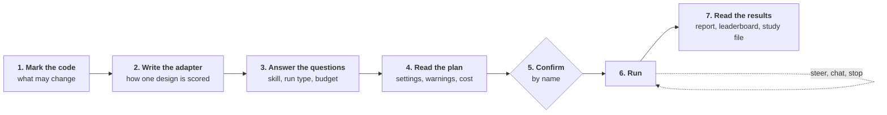
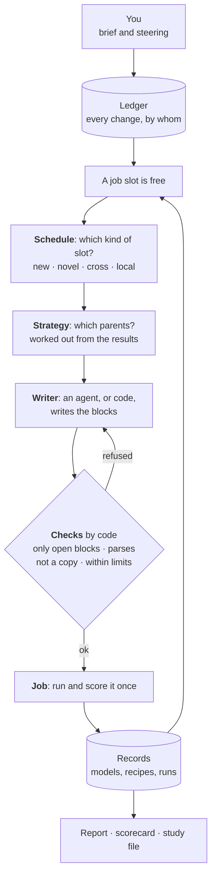

# evoloop

[](https://evoloop.readthedocs.io/en/latest/)

**Evolutionary search over a project's code, with language-model agents writing the designs and code
keeping the books.** Full documentation: <https://evoloop.readthedocs.io>

You mark the parts of your code that may change: a model's trunk, its head, the loss, the optimizer
settings. Agents write new versions of those parts. Code decides which design is tried next, trains
each one as its own job, keeps the score, and records every decision. You can change the course of the
search while it runs.

evoloop is built for model development, where one evaluation is a training run. It takes the ideas
of FunSearch and AlphaEvolve and fits them to a budget of tens to hundreds of evaluations, noisy scores,
and a person who wants to steer.

## Why another search loop

Program-search systems score a candidate in seconds and can afford millions of tries. Training a model
is a different situation, and it changes what a search loop has to be good at.

| | Program search | Model search |
|---|---|---|
| One evaluation | seconds on a CPU | minutes to hours on a GPU |
| Evaluations in a search | thousands to millions | tens to hundreds |
| The score | exact | noisy: two fits of one model differ |
| A wrong turn | costs little | costs a real share of the budget |

With few, costly, noisy evaluations, three things matter most, and evoloop is organised around them:

1. **Which design is tried next.** Exploration and exploitation are explicit shares of the budget, by
   phase, and the way parents are chosen is a strategy you pick.
2. **Not mistaking noise for progress.** You state the noise floor, and a difference below it counts as
   no difference everywhere: in selection, in lessons, in what is called a gain.
3. **Changing course without starting over.** Almost every setting can change during a run, each
   change is recorded with who made it, and scores from before and after a change that alters their
   meaning are never mixed.

## The workflow



## What happens for each design



Three rules hold everywhere:

- **Agents write and judge; code decides and records.** Whatever an agent returns is checked by code
  before it counts. The budget, the limits and the frozen code are enforced by code, never by a prompt.
- **Agents never talk to each other.** Each call is a fresh context built from the run's records, so a
  search can stop, restart, or change its agents at any point.
- **A guess is only ever a suggestion.** The tool proposes answers with reasons; nothing starts until
  you have read the plan and confirmed it by name.

## The two choices that decide most of the rest

A search is not one loop. It is put together from choices, and two of them set most of the others.

**The skill: what kind of problem is this?**

Skills come from a library of templates. A search gets its own copy of each skill it uses, to edit;
skills can be combined; and you can write your own.

| Domain | Skill | For |
|---|---|---|
| Models | `model-performance` | the best score, nothing else weighed |
| | `model-distillation` | a smaller or faster student that matches a teacher |
| | `model-efficiency` | the same score at a lower cost in parameters or time |
| | `model-size-frontier` | the best model at every size or speed across a broad range |
| | `model-training-recipe` | a better score from the same architecture, by training it better |
| | `model-ensemble-members` | a set of strong models whose errors do not coincide |
| | `model-finetuning` | the best score on a task starting from a pretrained model |
| | `model-mechanistic` | an interpretable or biophysical model improved without losing what its parameters mean |
| Settings | `settings-tuning` | the best settings of fixed code, by a Bayesian estimator in code, with no agent calls |
| Algorithms | `algorithm-runtime` | the same results in less time or memory |
| Bioinformatics | `bioinformatics-algorithm` | better accuracy against a truth set, at an acceptable run time |
| Pipelines | `data-pipeline` | the same output from a pipeline in less time, memory or cost |

<details>
<summary>What is in a skill</summary>

One editable file with:

- **settings** that suit the task (the search space, how designs are selected, the mix of moves);
- **guidance** for each agent: what matters, what to try first, what to avoid;
- **diagnoses**: "if the results show this, do that";
- **advice by stage** of the budget, early and late;
- **needs**: what your adapter must report, and rows the leaderboard should carry;
- a name, tags and an objective, so that the library can be searched (`evoloop skills --search WORDS`).

Combine them with `run.skill: [model-distillation, model-size-frontier]`. See
[Skills](docs/skills.md) and the [skill library](docs/skill-library.md).

</details>

**The run type: how should it search?**

| Run type | For |
|---|---|
| `explore_then_exploit` | most searches: mostly new designs first, then work on what was found |
| `refine` | a known good model: few families, mostly local changes |
| `survey` | a new problem: many kinds of design, each kept in play |
| `discovery` | long runs with cheap evaluations, aiming for something unusual |
| `settings_only` | a hyperparameter search |
| `custom` | your own description |

## What else you can choose

Everything below has a default, is shown in the plan with where its value came from, and can be changed
during a run.

| For | You choose |
|---|---|
| **Selection** | how parents are picked: families kept alive side by side (`lineage`), the best of each kind on a grid (`archive`), a tournament among recent designs (`tournament`), a trade-off front on two figures (`pareto`), or the best so far (`greedy`); on separate islands if wanted, with resets |
| **Exploration** | the shares of new designs, crossover and local moves by phase of the budget; a novelty dial; three kinds of crossover; diversity by family and size or by what the trained model does |
| **What may change** | settings only, one module, the architecture, the architecture and the training recipe, or your own list, role by role |
| **Cost of an evaluation** | weak designs stopped early by a single screen or a promotion ladder; a child trained from scratch or from its parent's weights |
| **The writers** | which Claude model and effort for each role; several models by share; whole blocks or find-and-replace edits; ways of working that are kept or dropped by their record |
| **Who decides** | code alone (deterministic), a strategist agent that may shift the course within bounds you set, or an agent that runs the search and that you talk to |
| **Oversight** | a cap on evaluations and one on model dollars; hard limits on size or speed; a scorecard of every agent and reviews at the points you choose |

`evoloop menu` prints every option with what it does, and `evoloop skills` the skills.

## Where the mechanisms come from

| From | Taken |
|---|---|
| FunSearch | marked regions of a program; islands with resets; designs kept apart by what they do |
| AlphaEvolve | an archive on islands; a fast and a strong model writing together; edits as diffs; an evaluation cascade; several objectives; instructions that evolve |
| Regularized evolution | tournament selection with aging |
| MAP-Elites | the best of each kind, on a grid |
| NEAT | new families protected while young |
| Successive halving, ASHA | weak runs stopped early by rank |
| TPE (Optuna, Hyperopt) | Bayesian choice of settings |

What evoloop adds to them: steering through a recorded ledger, periods that keep unlike scores apart, a
stated noise floor, explicit exploration and exploitation, skills, an agent you can talk to or none, an
audit of the agents, and a budget in both evaluations and dollars.
[How it compares](docs/compared.md) goes through each, including where evoloop falls short.

## What a search leaves behind

- **A leaderboard and a report**: the best designs with the baseline and any reference models, what
  each kind of move returned, what waits for your decision.
- **Every design**, with the code of its blocks, where it came from, what its writer predicted, and how
  it ended.
- **A ledger** of every change to the search, by whom, at how many evaluations.
- **A scorecard of the agents**: what each cost, whether its forecasts held, whether its choices paid.
- **A study file** in the CAMEO entry format, with every model, recipe and run, ready to deposit.

## Try it, at no cost

The package carries a small formula search with stub agents: no model call, no GPU, under a minute.

```
pip install git+https://github.com/cameo-db/evoloop
evoloop example demo                        # copies the example to ./demo
evoloop plan demo                           # every setting, with where it came from
evoloop brief demo --confirm "Your Name"    # your agreement to the plan
evoloop run demo --name first
evoloop report demo --name first
```

## Your own search

```
evoloop init mysearch --source path/to/project   # brief.yaml, task.md, base/, adapter/run.py
```

1. **Mark the code** in `base/`: `# EVOLVE-BLOCK-START name=trunk kind=structure role=trunk` ...
   `# EVOLVE-BLOCK-END`. Your original project is never touched; the search works on the snapshot.
2. **Write `task.md` and `adapter/run.py`**: what the agents are told, and how one design is trained.
   The adapter writes a `result.json` with the score.
3. **Answer the questions**: `evoloop setup mysearch` in a terminal, `evoloop form mysearch` for a page
   in a browser, or an agent in a chat. One question at a time, with choices, a suggested answer where
   there is evidence for one, and where you are in the list.
4. **Read the plan and confirm**: `evoloop plan mysearch` shows every setting with where it came from,
   the warnings, and an estimate of what the agents will cost. Then
   `evoloop brief mysearch --confirm "Your Name"`.
5. **Run**: `evoloop run mysearch --name r1`, on your machine or with one Slurm job per design.

## Steering while it runs

```
evoloop status mysearch --name r1                                  # where it stands, in a few lines
evoloop set    mysearch --name r1 schedule.novelty=0.6 budget.evaluations=300 --by "Your Name"
evoloop set    mysearch --name r1 run.skill=model-efficiency --by "Your Name"
evoloop note   mysearch --name r1 "No attention layers." --roles writer --by "Your Name"
evoloop force  mysearch --name r1 --mode cross --count 3 --by "Your Name"
evoloop steer  mysearch --name r1 "more novelty from here, and keep models small" --by "Your Name"
evoloop chat   mysearch --name r1 --by "Your Name"                 # talk to the agent that runs the search
evoloop stop   mysearch --name r1 --by "Your Name"
```

Every request is checked by code and recorded as applied or refused, with your name, the old value
and the new one. What defines the problem (the objective, the data, the frozen code) cannot change
within a run; what changes the meaning of a score (the length of a training run) starts a new period.

## What it costs

A search spends two things, and both are capped.

- **Evaluations**: training runs, on your compute. With a promotion ladder, a design stopped early is
  charged the share of the run it used.
- **Model dollars**: the agents. The plan estimates them before you confirm, the run paces itself toward
  the cap, and the stub backend costs nothing. The `settings-tuning` skill calls no agent at all.

## Requirements

- Python 3.9 or later, and `pyyaml`.
- Somewhere to train: the local machine, or a Slurm cluster (one job per design; the controller is a
  light process that can itself run as a job and requeue).
- For real agents: the Anthropic API (install with the `anthropic` extra, as in the docs) or the Claude Code
  command.

## Status

Version 0.2. It passes its tests on the built-in example with stub agents, and has run that example on
a real Slurm cluster. **It has not yet been run with a real agent or on a real training task**, and no
comparison of its strategies has been made. [Status and limits](docs/status.md) lists what has been
run, what has not, and what is not built.

## Documentation

<https://evoloop.readthedocs.io>, or the same pages in [`docs/`](docs/index.md):

| To | Read |
|---|---|
| see it work | [First run](docs/quickstart.md) |
| set up a search | [Setting up a search](docs/setting-up.md), [Skills](docs/skills.md), [Skill library](docs/skill-library.md), [The project's code](docs/project-contract.md) |
| decide between options | [How each choice changes the search](docs/choices.md) |
| understand the search | [How a search works](docs/how-it-works.md), [How it compares with established methods](docs/compared.md) |
| run and steer | [Steering a run](docs/steering.md), [The strategist and the budget](docs/strategist.md) |
| choose models and autonomy | [Model and effort](docs/models.md), [Agentic or harnessed, and what it costs](docs/autonomy.md) |
| check the agents and the results | [Auditing the agents](docs/auditing.md), [Records and the study file](docs/records.md) |
| look something up | [Menu of choices and presets](docs/menu.md), [Fields of the brief](docs/fields.md), [Commands](docs/commands.md) |
| help someone as an agent | [AGENTS.md](AGENTS.md) |

## Tests

```
pip install -e ".[test]"
pytest tests        # a few minutes on eight cores; run it on a compute node, not a login node
```

## License

MIT. Copyright (c) 2026 Peter Koo.
