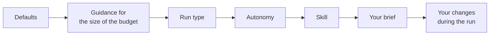

# How each choice changes the search

A search has a fixed budget, and every choice spends it differently. This page says, for each choice,
what it gives priority to and what that costs. The [menu](menu.md) has the exact settings.

## The axes

Five things trade off against each other:

| Axis | More of it means |
|---|---|
| **Exploration** | more kinds of design are tried; each gets fewer evaluations |
| **Exploitation** | the best designs are improved further; fewer kinds are tried |
| **Diversity kept** | designs that are different but behind stay in play as parents |
| **Designs per budget** | how many designs the same compute covers |
| **Agent cost** | model dollars per design |

In the tables, ▲ is more, ▼ is less, and a blank is no change.

## The skill: what is being optimised

A skill changes what counts as success, and through that the selection, the moves and the guidance.

| Skill | Success is | Selection | Moves it favours |
|---|---|---|---|
| `model-performance` | the best score | by score | whatever the results call for |
| `model-distillation` | a student near its teacher | by score | recipe changes before architecture changes |
| `model-efficiency` | the same score, cheaper | trade-off front: score and size | ablations (half the local moves) |
| `model-size-frontier` | the best design in every size band | the best of each band | new designs aimed at empty bands |
| `model-training-recipe` | a better-trained fixed model | by score | edits to loss, optimizer, schedule, augmentation |
| `model-ensemble-members` | good models that fail differently | the best of each behaviour group | new designs with a different bias |
| `model-finetuning` | the best adaptation of a pretrained model | by score | settings moves and edits to the head |
| `model-mechanistic` | a better fit that stays readable | by score | ablations and edits to the form of terms |
| `settings-tuning` | the best settings | by score | settings drawn by an estimator; no agent |
| `algorithm-runtime` | less time, same output | by measured time | algorithmic edits; wrong output is rejected |
| `bioinformatics-algorithm` | accuracy on a truth set | by score | edits to the model of the data and hard cases |
| `data-pipeline` | less cost, same output | by measured cost | restructuring steps; wrong output is rejected |

## The run type: how the budget is shared

| Run type | Exploration | Exploitation | Diversity kept | Agent cost |
|---|---|---|---|---|
| `explore_then_exploit` | ▲ early | ▲ late | | |
| `refine` | ▼ | ▲ | ▼ | |
| `survey` | ▲ | ▼ | ▲ | |
| `discovery` | ▲ | | ▲ | ▼ (lightest harness) |
| `settings_only` | ▼ | ▲ | ▼ | ▼ with the sampler or estimator |

## The strategy: who becomes a parent

| `strategy.mechanism` | Parents are | Exploration | Exploitation | Diversity kept | Best when |
|---|---|---|---|---|---|
| `lineage` | the best of several families, each with a quota | | | ▲ | most searches; new families get a protected trial |
| `archive` | the best of each cell of a grid | ▲ | ▼ | ▲▲ | coverage matters: a new problem, a size frontier, ensemble members |
| `tournament` | the best of a few recent designs | | ▲ | | large budgets; one lucky score must not dominate |
| `pareto` | designs on the trade-off front | | | ▲ | two goals: score with size or speed |
| `greedy` | the current best | ▼▼ | ▲▲ | ▼▼ | budgets too small for a population |

Islands (`strategy.islands`) raise diversity and split the budget; resets (`strategy.reset_every`)
stop a failing island from spending more.

## The schedule and novelty

| Setting | Raising it | Cost |
|---|---|---|
| share of `new` in `schedule.phases` | ▲ exploration | fewer evaluations to improve what was found |
| share of `local` | ▲ exploitation | the search may settle on a local optimum |
| share of `cross` | combines what two families do well | needs two good families to exist |
| `schedule.novel_share` | more designs built from rarely used parents | more designs that fail |
| `schedule.novelty` | a far-off proposal is preferred among several; rarely visited cells are drawn | fewer safe improvements |
| `schedule.adaptive` | shares follow what each mode has returned | early luck steers the schedule |

## What may change

| `space.preset` | Opens | Effect |
|---|---|---|
| `settings_only` | numbers | a cheap, narrow search |
| `module` | one part of the model | focused, with one cause for every result |
| `template` | the model, keeping its overall shape | improvement without replacement |
| `open_architecture` | the whole model | new architectures; more failures |
| `architecture_and_recipe` | the model and how it is trained | the widest search; needs the largest budget |

## Cost of an evaluation

| Setting | Designs per budget | Risk |
|---|---|---|
| `evaluation.screen_keep` below 1 (the default) | ▲ a little | a weak-starting new design is stopped |
| `evaluation.ladder` | ▲▲ (about 2.7 times with two halving rungs) | slow starters that end well are lost; agent cost rises with the number of designs |
| `evaluation.inherit_weights` | each child trains faster | a child is no longer comparable with a design trained from scratch |
| `evaluation.recheck_every` | ▼ slightly | none: it guards against a lucky leader |

## Who decides

| Choice | Agent cost | What you get |
|---|---|---|
| `harness.level`: `minimal` → `standard` → `full` | ▲ | lessons from the results, then re-checks of the leader |
| `harness.coordinator: agent` | ▲ (one call per slot) | an agent picks each slot from the options code prepares |
| `strategist.mode`: `off` → `advise` → `act` | ▲ a little | the shares, the novelty and the strategy adapt to the results, within bounds |
| `harness.conductor: agent` | ▲ per message | an agent that runs the search and that you can talk to |
| `harness.autonomy`: `harnessed` → `guided` → `agentic` | ▲ | a bundle of the above |

## The writers

| Setting | Effect | Cost |
|---|---|---|
| `agents.default_model`, `agents.effort` | stronger designs per call | ▲ agent cost |
| `agents.writer_mix` | a cheap model for most designs, a strong one for some | set by the shares |
| `variation.proposals_per_slot` | several proposals, one trained: bolder ideas get a chance | ▲ output tokens |
| `variation.edit_format: diff` | local moves returned as edits | ▼ output tokens on large blocks |
| `variation.approaches` | ways of working kept or dropped by their record | none; needs the analyst to add new ones |
| `variation.settings_by: tpe` | settings drawn by an estimator in code | ▼ no agent call for settings moves |

## Recipes

Starting points for common aims. Each is a few lines of the brief.

| Aim | Brief |
|---|---|
| a better model, 100 evaluations | `run.type: explore_then_exploit`, `run.skill: model-performance` |
| a small student for an ensemble | `run.skill: model-distillation`, then `model-size-frontier` added once a recipe works |
| models for three deployment sizes | `run.skill: model-size-frontier`, `limits` for the smallest and largest size |
| the cheapest possible tuning | `run.skill: settings-tuning`, `space.ranges`, `evaluation.ladder` |
| many designs on a tight compute budget | `evaluation.ladder`, `harness.level: minimal`, a cheaper writer model |
| a search you want to talk to | `harness.conductor: agent`, `strategist.mode: advise` |

## Where each setting's value comes from

A later layer wins over an earlier one. The skill comes after the run type and the level of autonomy
because it knows the problem: a skill that searches without agents stays without agents whatever level
of autonomy is chosen. What you set yourself always stands. `evoloop plan` leads with what the search
will actually do and says where one choice overrode another.
