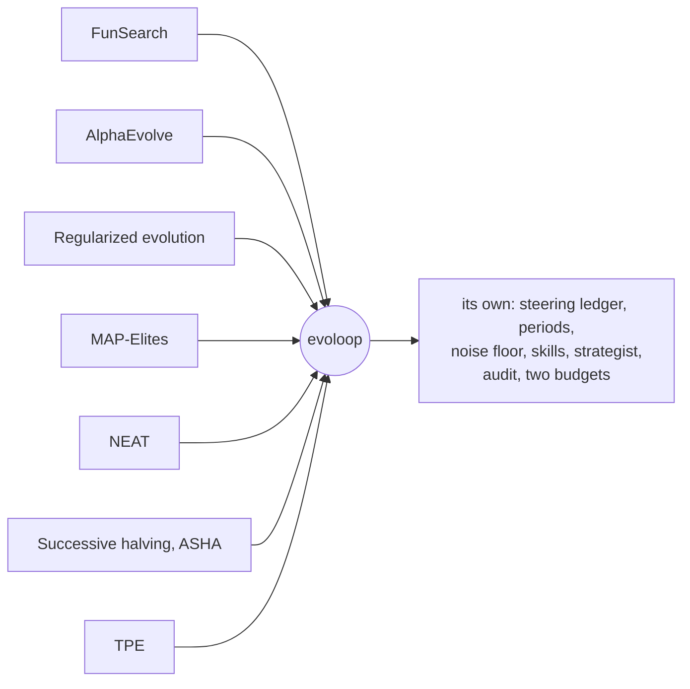

# How it compares with established methods

evoloop is put together from mechanisms that others introduced and tested. This page says which, how
each appears here, and where evoloop differs or falls short. Every mechanism below is an option; the
[menu](menu.md) lists the settings.

## The situation it is built for

FunSearch and AlphaEvolve search over programs that are scored in seconds, so they can afford
thousands to millions of evaluations, and a score is the same every time it is measured. A search over
model architectures is a different situation:

| | Program search (FunSearch, AlphaEvolve) | Architecture search |
|---|---|---|
| One evaluation | seconds, on a CPU | minutes to hours, on a GPU |
| Evaluations in a search | thousands to millions | tens to hundreds |
| The score | exact | noisy: two fits of one model differ |
| What a wrong turn costs | little | a real share of the budget |

So evoloop takes their mechanisms and changes the weight put on each. With a few hundred evaluations,
what matters most is which design is tried next, that a noisy score is not mistaken for a gain, and that
the person can change course when the results call for it.

## What is taken from where

### From FunSearch

| Mechanism | In evoloop | How it differs here |
|---|---|---|
| Evolve one function inside a fixed skeleton | `EVOLVE-BLOCK` markers in `base/`; the rest is frozen and hashed | several blocks, each with a kind and a role, so the space can be opened role by role |
| Islands, the weaker half reset at intervals | `strategy.islands`, `strategy.reset_every` | off by default: islands split a small budget thinly |
| Programs kept apart by what they do | `strategy.descriptors: [behaviour]` | grouped by where a trained model's errors fall, by correlation, not by an exact match |

### From AlphaEvolve

| Mechanism | In evoloop | How it differs here |
|---|---|---|
| A program database: an archive on islands | `strategy.mechanism: archive` with `strategy.islands` | cells are family, size, behaviour or any reported metric |
| A fast and a strong model writing together | `agents.writer_mix` | any models and shares; the report compares their designs |
| Edits as diffs | `variation.edit_format: diff` | an edit applies only if its text occurs exactly once in the block |
| An evaluation cascade | the quick check, then `evaluation.ladder` | successive halving inside one job, not a set of cheaper tests |
| Several objectives | `strategy.mechanism: pareto` | two figures, not many |
| Instructions that evolve | `variation.approaches` | one line per slot varies, with a record of what it led to |

### From other methods

| Method | Mechanism | In evoloop | How it differs here |
|---|---|---|---|
| Regularized evolution | tournament selection with aging | `strategy.mechanism: tournament` | as published, at smaller scale |
| MAP-Elites | the best of each kind, on a grid | `strategy.mechanism: archive` | the grid's axes are yours to choose |
| NEAT | new species protected while young | `strategy.mechanism: lineage` | families of designs, not genomes; the default |
| Successive halving, ASHA | weak runs stopped by rank | `evaluation.ladder` | within one job, charged by the share of the run used |
| TPE (Optuna, Hyperopt) | Bayesian choice of settings | `variation.settings_by: tpe` | a small implementation; each setting modelled alone |
| Network morphism, weight sharing | a child starts from its parent's weights | `evaluation.inherit_weights` | the adapter decides what to load |

## What evoloop adds

These are not in the methods above, and are the reason for the package.

- **Steering without a restart.** Every setting that does not define the problem can be changed while a
  search runs, through a ledger that records who changed what and when. A strategy keeps no state, so
  even the strategy can change. See [Steering a run](steering.md).
- **Changes that alter what a score means.** Lengthening the training run, changing the data fraction or
  the adapter starts a new *period*: the leaders are fitted again and earlier scores stop deciding
  selection, so old and new scores are never compared as if they were alike.
- **Noise treated as a fact.** You give the noise floor; a difference below it is no difference in
  selection, in the trade-off front, in a lesson's status, and in what counts as a gain. The leader can
  be fitted again on a new seed at intervals.
- **Explicit exploration and exploitation.** The schedule sets the shares of new designs, crossover and
  local moves by phase of the budget, kept by counting, and a strategist agent may shift them within
  bounds you set. See [the strategist](strategist.md).
- **Skills.** What kind of optimisation a search is (a better score, a distilled student, tuned
  settings, a smaller model, an interpretable model) is chosen apart from how to search. See
  [Skills](skills.md).
- **An agent you can talk to, or none.** The course of a search is run by code, deterministically, or by
  an agent that answers you and acts within the same bounds.
- **An audit of the agents.** Every call is recorded with what the agent was shown, what it forecast and
  what happened; a scorecard and reviews say whether each role is earning its cost.
- **A budget in two currencies.** Evaluations and model dollars are both capped, with the plan's
  estimate of the agents' cost shown before you confirm.
- **A study file.** A finished search is written out in the CAMEO entry format, with every model, recipe
  and run, so it can be deposited and compared.

## Where it falls short of them

- **Throughput.** There is no tier of cheap stand-in evaluations (a smaller dataset or model) with
  promotion to the real task. The ladder stops weak designs early within the real task, which
  stretches a budget a few-fold, not a thousandfold.
- **Scale of evidence.** FunSearch and AlphaEvolve have published results. evoloop has passed its tests
  on a built-in example with stub agents; it has not yet been run with a real agent on a real training
  task. See [Status and limits](status.md).
- **Novelty before training.** How different a proposal is from what has been tried is measured on its
  code. What a model does is known only after it is trained.
- **Prompt evolution.** Only one line of the writer's instructions varies.
- **Scope of an edit.** A writer changes marked blocks. It cannot restructure the frozen code around
  them.

## Choosing settings that resemble a method

| To search like | Set |
|---|---|
| FunSearch | `strategy.mechanism: archive`, `strategy.descriptors: [behaviour]`, `strategy.islands: 4`, `strategy.reset_every: 40`, `harness.level: minimal` |
| AlphaEvolve | `strategy.mechanism: archive` on `strategy.islands: 3`, `agents.writer_mix`, `variation.edit_format: diff`, `variation.approaches: evolve`, `evaluation.ladder` |
| Regularized evolution | `strategy.mechanism: tournament`, a schedule of local moves only |
| Hyperband with a Bayesian sampler (BOHB) | `run.skill: settings-tuning` with `evaluation.ladder` |
| A hill climb | `strategy.mechanism: greedy` |

These resemble the methods; they are not reimplementations of them, and they need budgets in the
hundreds to behave as described.

## Sources

- Romera-Paredes et al., "Mathematical discoveries from program search with large language models", *Nature*, 2024 (FunSearch).
- Novikov et al., "AlphaEvolve: A coding agent for scientific and algorithmic discovery", 2025.
- Real et al., "Regularized Evolution for Image Classifier Architecture Search", *AAAI*, 2019.
- Mouret and Clune, "Illuminating search spaces by mapping elites", 2015 (MAP-Elites).
- Stanley and Miikkulainen, "Evolving Neural Networks through Augmenting Topologies", *Evolutionary Computation*, 2002 (NEAT).
- Li et al., "Hyperband: A Novel Bandit-Based Approach to Hyperparameter Optimization", *JMLR*, 2018; Li et al., "A System for Massively Parallel Hyperparameter Tuning", *MLSys*, 2020 (ASHA).
- Bergstra et al., "Algorithms for Hyper-Parameter Optimization", *NeurIPS*, 2011 (TPE).
- Falkner et al., "BOHB: Robust and Efficient Hyperparameter Optimization at Scale", *ICML*, 2018.
