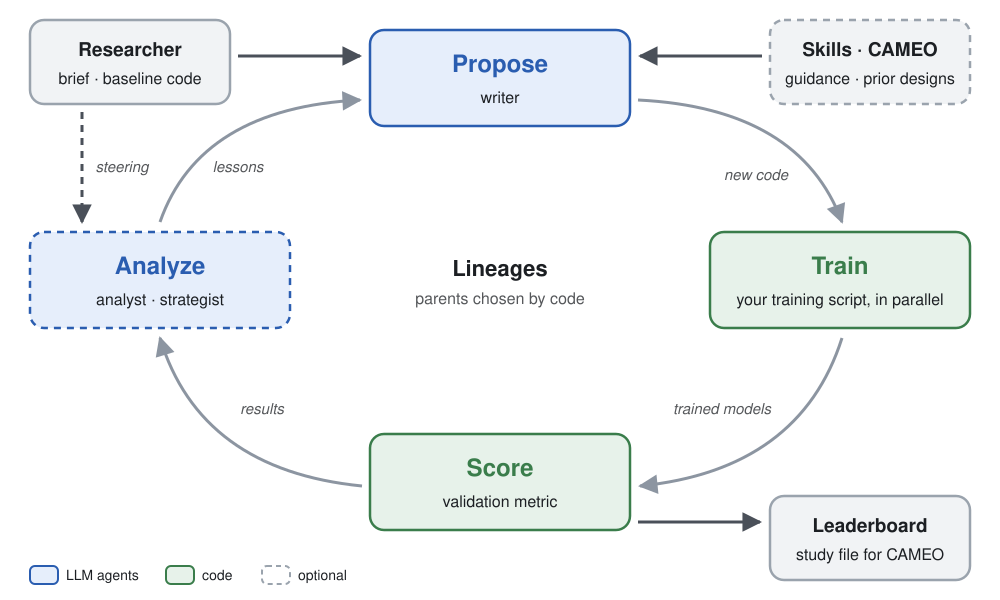

# How it works

evoloop has four parts. The *controller* is a Python process that runs the search. The *agents* are
LLM calls that the controller makes. The *evaluator* is your script, which the controller runs as
jobs. The *run folder* holds everything the search knows, as files.



This page follows one design through the loop and then describes each part.

## Example trace

Take the built-in demo, a search for a small classifier, after 16 designs have been scored. A job
finishes, so a slot is free.

1. The schedule picks the kind of move. The search is 40% through its budget. In this phase the
   schedule gives 65% of evaluations to new designs, 10% to crossover and 25% to local moves, and local
   moves are furthest behind their share. This slot is a local move. [Schedule](schedule.md)

2. The strategy picks the parent. The leading lineage, built on inputs that vary with the radius, has
   its best design at 0.967. That design is the parent. [Parent selection](parents.md)

3. The writer writes the change. A local move is an edit, a hyperparameter change or an ablation, and
   this one is an edit. The writer is sent the parent's code, the leaderboard, recent results and the
   lessons so far. It returns one change, a second hidden layer, with a hypothesis and a forecast.
   [Moves](moves.md)

    ```python
    HIDDEN = [12]        ->        HIDDEN = [12, 8]
    ```

4. Code checks the change. Only marked blocks may differ from the parent, the code must parse, no
   forbidden term may appear, and the design must not be a copy of one already tried. A design that
   fails is sent back to the writer or dropped. It costs no evaluation.

5. The evaluator trains and scores it. The design runs as its own job: your evaluator trains it and
   writes a `result.json` with the score, here 0.970. If the evaluator reports progress during
   training, a design that is clearly behind can be stopped part way.
   [Early stopping](early-stopping.md)

6. The result is recorded. The design, its code, its parent, the writer's forecast and the score are
   appended to files in the run folder. The next slot is decided from those files, and so is
   everything an agent is shown later.

In the demo the writer is a script. With an LLM, the exchange in step 3 looks like this.

??? note "The request to the writer and its reply (abridged)"
    ```json
    {"request": {"mode": "local", "move": "structural_change", "step": "normal",
                 "instruction": "ONE attributable change to the parent's structure..."},
     "blocks_you_may_change": {"model": {"kind": "structure", "role": "network"},
                               "fit": {"kind": "params", "role": "optimizer"}},
     "parents": [{"candidate": "C14", "score": 0.967, "family": "periodic features",
                  "blocks": {"model": "HIDDEN = [12]\nACTIVATION = \"tanh\"\n\ndef features(x): ..."}}],
     "leaderboard": ["..."], "recent": ["..."], "lessons": ["..."]}
    ```

    ```json
    {"proposals": [{"name": "a second layer", "family": "periodic features",
                    "hypothesis": "A second layer lets the network combine the radial waves with the coordinates.",
                    "expected_gain": {"gain": 0.8, "probability_better": 0.4},
                    "change_summary": "added a narrower layer on top",
                    "blocks": {"model": "HIDDEN = [12, 8]\nACTIVATION = \"tanh\"\n\ndef features(x): ..."}}]}
    ```

## Controller

`evoloop run` starts the controller. Every few seconds it takes a turn:

1. It applies or refuses any steering requests you sent (`evoloop set`, `note`, `stop`).
2. It checks the running jobs, collects results, and stops a design that is behind at an
   early-stopping point or outside a limit.
3. It checks and records the designs the agents have finished writing.
4. It calls the analyst, strategist or assessor if one is due.
5. For each free job slot, while budget remains, it starts a new design as in the trace above.
6. It writes `status.json`.

The controller keeps no state that is not on disk. If it stops, `evoloop run` with the same name
continues from the files, and picks up jobs that were still running.

## Agents

Each role is a separate LLM call with its own instructions. Roles never call each other. The
controller sends each one what it needs from the run folder.

| Role | Called | Returns |
|---|---|---|
| writer | for each design that is not made in code | new code for the marked blocks, a hypothesis, a forecast |
| analyst | every 8 finished designs | lessons, each citing the runs that support it |
| strategist | every 15 scored designs, and on a plateau | up to two decisions from a fixed list, which code checks before applying |
| coordinator | every slot, if switched on | which kind of move to make, from the options code prepared |
| assessor | at points you choose | a review of each other role, for you |
| translator | when you run `evoloop steer` | your words as setting changes and notes, shown to you before they apply |

Only the writer is required. [Agents](agents.md) covers what each role is sent, how much the agents
are allowed to decide, and which model they run on.

## Skills and settings

A [skill](which-search.md) acts in two places. When the brief is read, the skill's settings are laid
over the run type's. On every call to a writer, analyst, strategist or coordinator, the skill's
guidance for that role is added to what the agent is sent. Without a skill, the agents are sent your
`task.md` and your notes only.

A setting can be given in several places. The first of these that sets it wins: a change you make
during the run, your brief, the skill, the autonomy level, the run type, the defaults for your budget
size, the site file for your machine, the built-in default. `evoloop plan` prints the source of every
value.

## Guarantees

These hold under every setting, because they are checks in code and not instructions to an agent.

- The budget in evaluations, and the cap on agent spend.
- Any `limits` on metrics your evaluator reports, such as parameter count.
- Only marked, open blocks change. The rest of your code is checked by hash at every start.
- At least 10% of evaluations go to new designs while a strategist is adjusting the schedule.
- Every design, score, agent call and setting change is appended to files in the run folder.

## Source files

| Part | File |
|---|---|
| The controller and its turn | [controller.py](https://github.com/cameo-db/evoloop/blob/main/evoloop/controller.py) |
| Kind of move for a slot | [schedule.py](https://github.com/cameo-db/evoloop/blob/main/evoloop/schedule.py) |
| Parent selection | [strategies/](https://github.com/cameo-db/evoloop/blob/main/evoloop/strategies) |
| Writing a design, and moves made without an agent | [design.py](https://github.com/cameo-db/evoloop/blob/main/evoloop/design.py) |
| Agent roles and their instructions | [agents.py](https://github.com/cameo-db/evoloop/blob/main/evoloop/agents.py) |
| Checking a design against the marked blocks | [space.py](https://github.com/cameo-db/evoloop/blob/main/evoloop/space.py) |
| Running the evaluator, locally or on Slurm | [jobs.py](https://github.com/cameo-db/evoloop/blob/main/evoloop/jobs.py) |
| The run folder | [store.py](https://github.com/cameo-db/evoloop/blob/main/evoloop/store.py) |
| Settings and where each value comes from | [form.py](https://github.com/cameo-db/evoloop/blob/main/evoloop/form.py) |
| Skills | [skill.py](https://github.com/cameo-db/evoloop/blob/main/evoloop/skill.py) |

[Code map](code.md) lists every module and function. [Files of a run](records.md) lists what is in
the run folder.
