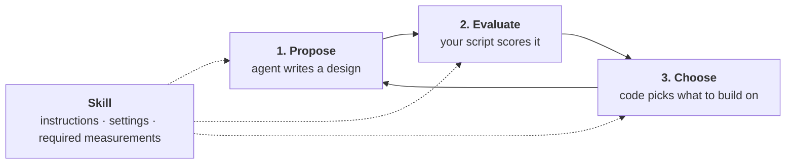

# How a search works

A search is a loop with three stages. An agent proposes a change to the marked code, your script
scores it, and evoloop's code decides what to build on next. The skill you chose is read at each stage.



Five settings account for most of what a search does. Each section gives the default, when to change
it, and a link to the details.

## 1. What kind of change is proposed

Every evaluation is a new design, a crossover of two designs, or a local move on one design (an edit, a
hyperparameter change, or an ablation). New designs explore and local moves exploit.

The default spends 65% of the first 60% of the budget on new designs, then 60% of the rest on local
moves. That suits a search that starts without a good model. If you already have one, use
`run.type: refine`, which spends 70% on local moves from the start. If you do not yet know which kind of
model works, use `survey`.

[Schedule](schedule.md) · [Moves](moves.md)

## 2. Which designs are built on

The parent rule (`strategy.mechanism`) picks the design a local move starts from.

=== "lineage (default)"

    Keeps several families of designs and spreads edits across them. A new family gets two evaluations
    before it is compared with the others, and no family gets more than 40% of the edits. Use it for
    50 to 300 evaluations when you want one best model.

=== "greedy"

    Every edit starts from the current best. Use it below about 40 evaluations, where there is no time
    to maintain families.

=== "archive"

    Keeps the best design of each kind, by family and size, or by where a model's errors fall. Use it
    when you want coverage: several sizes, or ensemble members that fail differently.

=== "pareto"

    Keeps the designs that are best on the score and a second metric together, such as parameter
    count. Use it when size or speed matters as well as accuracy.

=== "tournament"

    Picks the best of three recent designs and forgets old ones. Use it with several hundred noisy
    evaluations, so one lucky score cannot lead for long.

Most skills set this for you. [Parent selection](parents.md) has a figure that shows the rules at work.

## 3. How much of each evaluation is run

By default a new design is compared with earlier new designs half way through training, and the weaker
half stop there. This needs your script to report progress.

Leave the default unless your models are slow starters, in which case set `evaluation.screen_keep: 1`
to switch it off. With several hundred evaluations and reliable early progress, `evaluation.ladder`
stops designs at several points and makes the same budget cover two to three times as many.

[Early stopping](early-stopping.md)

## 4. Whether a gain is real

Two training runs of the same design give different scores. You tell evoloop how different
(`evaluation.noise`), and it ignores gains smaller than that. This number matters more than most
settings. Set too low, the search builds on luck. Set too high, it ignores real progress.

Measure it before a real search by training the baseline five times. The leader is also retrained on
a new seed every 20 designs, and ranked by the mean.

[Measure your noise](noise.md) · [Comparing scores](comparable.md)

## 5. How much the agents decide

In the default set-up, code picks the kind of move and the parent, a writer agent writes the design,
and an analyst agent summarizes results every 8 designs. A strategist agent may adjust the split
between new designs and local moves within limits.

Two things can be changed. `harness.autonomy: harnessed` removes the strategist and cuts agent calls by
about a fifth. `agentic` lets an agent pick the kind of move for every slot and roughly doubles the
calls. Whether the extra calls buy better results has not been measured.

[Agents](agents.md) · [Budget and cost](cost.md)

## What is fixed

Whatever the settings, an agent only returns text. evoloop's code runs the jobs, enforces the budget
and any limits, checks that a design changes only the marked blocks, and writes every design, score and
decision to disk. A search can be stopped and resumed from those files, and most settings can be
changed while it runs.

## One evaluation, traced

??? note "A local move from the built-in example, step by step"

    Take the built-in demo, a search for a small classifier, after 16 designs have been scored. A job
    finishes and a slot is free.

    **1. What kind of move?** The search is 40% through its budget, where the plan gives 65% of
    evaluations to new designs, 10% to crossover and 25% to local moves. So far local moves are furthest
    behind their share, so this slot is a local move. [What gets tried next](schedule.md) explains the
    shares.

    **2. Which parents?** The search keeps several families of designs. The family built on inputs that
    vary along the radius leads, at 0.967, and its best design is chosen as the parent.
    [Who becomes a parent](parents.md) explains how.

    **3. Write it.** A local move is an edit, a settings move or an ablation. This one is an edit: the
    writer is sent the parent's code, the leaderboard, recent results and the lessons so far, and asked for
    one change. It adds a second hidden layer.

    ```python
    HIDDEN = [12]        ->        HIDDEN = [12, 8]
    ```

    In the demo the writer is a script. In a real search it is an agent, and the exchange looks like this:

    ??? note "The request and the reply (abridged)"
        The request:

        ```json
        {"request": {"mode": "local", "move": "structural_change", "step": "normal",
                     "instruction": "ONE attributable change to the parent's structure..."},
         "blocks_you_may_change": {"model": {"kind": "structure", "role": "network"},
                                   "fit": {"kind": "params", "role": "optimizer"}},
         "parents": [{"candidate": "C14", "score": 0.967, "family": "periodic features",
                      "blocks": {"model": "HIDDEN = [12]\nACTIVATION = \"tanh\"\n\ndef features(x): ..."}}],
         "leaderboard": ["..."], "recent": ["..."], "lessons": ["..."]}
        ```

        The reply, with the new code and a forecast:

        ```json
        {"proposals": [{"name": "a second layer", "family": "periodic features",
                        "hypothesis": "A second layer lets the network combine the radial waves with the coordinates.",
                        "expected_gain": {"gain": 0.8, "probability_better": 0.4},
                        "change_summary": "added a narrower layer on top",
                        "blocks": {"model": "HIDDEN = [12, 8]\nACTIVATION = \"tanh\"\n\ndef features(x): ..."}}]}
        ```


    Some moves need no agent: a block swap between two parents, and settings drawn by a sampler, are made
    in code. [Edits, crossover and settings moves](moves.md) lists them.

    **4. Check it.** Before anything is trained, Python checks that only the marked blocks changed, that
    the code parses, that no forbidden term appears, and that the design is not a copy of one already
    tried. A design that fails goes back to step 3 or is dropped; it costs nothing.

    **5. Run and score it.** The design runs as its own job: your evaluator trains it and writes a
    `result.json` with the score. Here it scores 0.970. If the evaluator reports progress, a design that is
    clearly behind can be stopped part way ([Cheaper evaluations](early-stopping.md)).

    **6. Record.** The design, its code, its parent, the agent's forecast and the result are appended to
    the run's files. The next slot is chosen from those files, and so is everything an agent is shown
    later.


## Related

[Comparison with FunSearch and AlphaEvolve](compared.md) · [Glossary](glossary.md)
