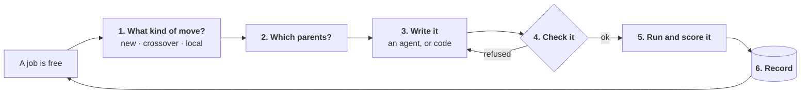

# One step of a search

A search repeats one step until the budget is spent: choose what to try, have it written, check it, run
it, record the score. This page follows a single design through that step. The pages after it take
each part in turn.



## An example

Take the built-in demo, a search for a small classifier, after 16 designs have been scored. A job
finishes and a slot is free.

**1. What kind of move?** The search is 40% through its budget, where the plan gives 65% of
evaluations to new designs, 10% to crossover and 25% to local moves. So far local moves are furthest
behind their share, so this slot is a local move. [What gets tried next](schedule.md) explains the
shares.

**2. Which parents?** The search keeps several families of designs. The family built on inputs that
vary along the radius leads, at 0.967, and its best design is chosen as the parent.
[Who becomes a parent](parents.md) explains how.

**3. Write it.** A local move is an edit, a settings move or an ablation; this one is an edit. An agent
is sent the task, the parent's code, the leaderboard, recent results and the lessons so far, and asked
for one change:

```json
{"request": {"mode": "local", "move": "structural_change", "step": "normal",
             "instruction": "ONE attributable change to the parent's structure..."},
 "blocks_you_may_change": {"model": {"kind": "structure", "role": "network"},
                           "fit": {"kind": "params", "role": "optimizer"}},
 "parents": [{"candidate": "C14", "score": 0.967, "family": "periodic features",
              "blocks": {"model": "HIDDEN = [12]\nACTIVATION = \"tanh\"\n\ndef features(x): ..."}}],
 "leaderboard": ["..."], "recent": ["..."], "lessons": ["..."]}
```

It answers with the new code and a forecast:

```json
{"proposals": [{"name": "a second layer", "family": "periodic features",
                "hypothesis": "A second layer lets the network combine the radial waves with the coordinates.",
                "expected_gain": {"gain": 0.8, "probability_better": 0.4},
                "change_summary": "added a narrower layer on top",
                "blocks": {"model": "HIDDEN = [12, 8]\nACTIVATION = \"tanh\"\n\ndef features(x): ..."}}]}
```

(Both are abridged.) Some moves need no agent: a block swap between two parents, and settings drawn by
a sampler, are made in code. [Edits, crossover and settings moves](moves.md) lists them.

**4. Check it.** Before anything is trained, Python checks that only the marked blocks changed, that
the code parses, that no forbidden term appears, and that the design is not a copy of one already
tried. A design that fails goes back to step 3 or is dropped; it costs nothing.

**5. Run and score it.** The design runs as its own job: your evaluator trains it and writes a
`result.json` with the score. Here it scores 0.970. If the evaluator reports progress, a design that is
clearly behind can be stopped part way ([Cheaper evaluations](early-stopping.md)).

**6. Record.** The design, its code, its parent, the agent's forecast and the result are appended to
the run's files. The next slot is chosen from those files, and so is everything an agent is shown
later.

## What decides what

An agent only ever returns text: a block of code, a forecast, a lesson, a suggestion. Python decides
which design is trained next, stops the search at the budget, and refuses a design that touches code
outside the marked blocks or breaks a limit you set.

Each agent call is built from the run's files and remembers nothing else. That is why a search can be
stopped and continued, and why the model behind a role can be changed in the middle of a run.

## When a design fails

A design that crashes, or fails the quick check, has no score. The first ten such designs are not
charged to the budget (`budget.max_uncounted_failures`); after that each one counts as an evaluation, so
a search whose designs all break still ends. If eight designs in a row end without a score, the search
stops and says it has stalled.

## The parts, one page each

- [What gets tried next](schedule.md): the shares of new designs, crossover and local moves.
- [Who becomes a parent](parents.md): the five strategies, and islands.
- [Edits, crossover and settings moves](moves.md): what each kind of move does.
- [Cheaper evaluations](early-stopping.md): stopping weak designs early.
- [When two scores can be compared](comparable.md): noise, re-checks, and changes during a run.
- [The agents, and how much they decide](agents.md): the roles, and the three levels of autonomy.
- [Compared with FunSearch and AlphaEvolve](compared.md).

Unfamiliar word? See the [glossary](glossary.md).
