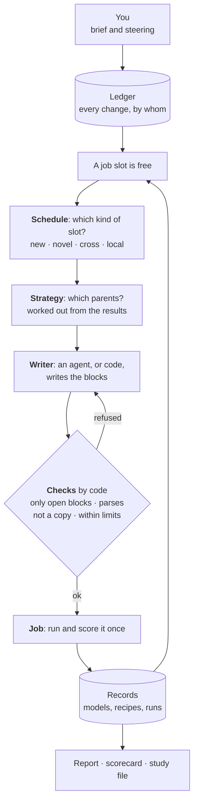

# How a search works



Three rules hold everywhere:

- **Agents write and judge; code decides and records.** Whatever an agent returns is checked by code
  before it counts. The budget, the limits and the frozen code are enforced by code, never by a prompt.
- **Agents never talk to each other.** Each call is a fresh context built from the run's records, so a
  search can stop, restart, or change its agents at any point.
- **A guess is only ever a suggestion.** The tool proposes answers with reasons; you see every one and
  can change it.


## One design at a time

A design is written only when it can run. Each time a job slot is free:

1. **The schedule picks the mode** of the slot.
2. **The strategy picks the parents**, from the results alone.
3. **A writer makes the design**: an agent writes the open blocks, or code does (a block swap, sampled
   settings).
4. **Code checks it**: only open blocks changed, the code parses, no forbidden term, not an exact copy
   of a design already tried.
5. **It is trained once and scored.** The score joins the results the next slot is chosen from.

Every design is fitted once. A second fit happens only as a re-check of the leader, or when the length
of a run is changed.

## The schedule: modes and phases

Four modes share the evaluations:

| Mode | What the slot does |
|---|---|
| `new` | a new family from the known design space |
| `novel` | a design built from or against designs that were rarely built on |
| `cross` | a crossover of two lineages |
| `local` | one change, a settings move or an ablation on an existing lineage |

`schedule.phases` gives the shares by phase. The default is exploration first, then exploitation:

| Phase | New designs | Crossover | Local |
|---|---|---|---|
| the first 60% of the budget | 65% | 10% | 25% |
| the rest | 15% | 25% | 60% |

`schedule.novel_share` splits the new designs into `new` and `novel` (a third novel by default).

The mix is met by counting, not by drawing: each slot goes to the mode furthest behind its share, so a
short run gets the mix it was promised. A mode with nothing to do passes its share on: crossover needs
two scored lineages, a local move needs one scored design.

**Adaptive schedule.** With `schedule.adaptive` above 0 the shares are blended with what each mode has
returned so far, each mode keeping at least `schedule.floor`. A gain is credited partly to the move
that made it and partly (`schedule.founder_credit`, half by default) to the slot that founded the
lineage. Without that, a new design is never credited for what was later built on it, and the figures
always favour local moves. It is off by default.

## The strategies

A strategy answers one question: for a slot of this mode, which candidates are the parents? It keeps no
state of its own, so the strategy can be changed during a run.

**`lineage`** keeps species alive side by side.

- A lineage is founded by a new design, a block swap or a hybrid.
- Until it has had `population.trial_runs` runs it is in a protected trial: it is owed local moves
  before anything else and is not compared with other lineages.
- The `population.lineages` best lineages that finished their trial are active. The rest sit on the
  bench, where they can still be a crossover partner.
- No lineage takes more than `population.quota` of the local slots.
- The lineage is drawn by rank, favouring those built on least; within it the parent is drawn among
  the candidates tied with its best within the noise.
- After `population.retire_after` local moves in a row with no gain above the noise, it retires.

**`archive`** keeps the best of each kind of design. Every scored design falls in a cell given by
`strategy.descriptors` (its family label and a size bin by default). Parents are drawn across the
cells; `schedule.novelty` moves the draw from "by rank" (0) to "by how rarely a cell has been built
on" (1). A design that is different but behind stays in play.

**`tournament`** draws `strategy.tournament_size` of the `strategy.window` most recent designs and
builds on the best of them. Old designs leave the population however good they were.

**`pareto`** builds on the designs that are best on two things at once: the score and a second figure
named by `strategy.second_metric` (`parameters`, `examples_per_s`, `training_minutes`, or a metric the
runs report; `strategy.second_direction` says whether less or more is better).

- A design is on the front when no other design is at least as good on both and better on one. A
  difference in score below the noise does not push a design off it.
- Parents are drawn from the front; `schedule.novelty` moves the draw toward the designs that stand
  alone on it, so the trade-off is filled in and pushed outward.
- A crossover pairs designs from different parts of the front (a small one with an accurate one).
- A design that reports no value for the second figure counts as worst on it.

The score alone still decides the leaderboard, the baseline comparison and the strategist's plateau.

**`greedy`** builds on the current best.

**Islands.** `strategy.islands: N` runs N populations of the chosen strategy apart. A slot goes to the
island with the fewest runs, and that island sees only its own results. Every
`strategy.migrate_every` scored runs, the best design of another island is brought in as a parent.
Islands split the budget: on a small one each island gets few runs, and the plan warns.

**Island resets.** With `strategy.reset_every: N` (0, the default, is never), every N scored runs of
the whole search the weaker half of the islands start again, as in FunSearch. What they held stays in
the record and on the leaderboard but is no longer their population, and the first slot of each is a
local move on the best design of an island that was kept. An island that went nowhere stops spending
slots on the same ideas.

| Like | Settings |
|---|---|
| FunSearch | `strategy.islands: 4`, `strategy.reset_every: 40`, `strategy.mechanism: archive`, `strategy.descriptors: [behaviour]` |
| AlphaEvolve's program database | `strategy.mechanism: archive` on `strategy.islands: 3`, with `evaluation.ladder` |
| Regularized evolution | `strategy.mechanism: tournament` |

These need budgets in the hundreds: see the guidance by size of budget.

## Crossover

| Kind | What happens | Written by |
|---|---|---|
| `block_swap` | whole marked blocks taken from each parent | code |
| `graft` | the one change that gained most in the donor's history, applied to the recipient | an agent |
| `hybrid` | one design written from the two parents | an agent |

Only the kinds listed in `crossover.kinds` are used. When none of them is possible for a pair (a block
swap needs two open blocks that differ, a graft needs a recorded gain in the donor's lineage), the slot
becomes a local move and the run's record says so.

**The partner.** The first parent is drawn by score. The second is the candidate whose errors fall
least like the first one's, when the adapter reports where a model's errors fall (`signature` in
`result.json`); otherwise one of another family. Two designs that fail in different places are the
pair worth combining.

## Local moves

`schedule.local_mix` shares the local slots between `edit` (one structural change), `settings` (only
values in the params blocks) and `ablation` (one component removed). With
`variation.step_adaptation`, a lineage whose recent edits gained often is asked for bolder ones, and
one whose edits rarely gained for smaller ones.

A settings move is made by an agent, by a sampler that nudges one value, or by a Bayesian estimator that
draws every setting from what the best designs used (`variation.settings_by`: `agent`, `sampler`, `tpe`;
see [the tuning skill](skills.md#the-tuning-skills-estimator)). The last two cost no agent call.

## Novelty

- **Novel slots** show the writer designs that were rarely built on, from anywhere in the ranking, and
  ask for something unlike the leader.
- **Several proposals per slot.** With `variation.proposals_per_slot` above 1 the writer returns
  several proposals with a forecast for each. One is trained: the one with the best forecast plus a
  bonus for distance from every design tried, scaled by `schedule.novelty`. A bold idea gets its chance
  at the cheap stage, before a training run is spent.
- **The archive** keeps what is different.
- **Specialists.** With `evaluation.speciality_metrics`, a parent is sometimes the design best on one
  metric rather than best overall.

**Two measures of difference.**

- *On the code*: the share of three-token runs two designs have in common. This is all that can be
  known of a proposal before it is trained, so the choice among proposals uses it. A proposal is not
  refused for being similar; only an exact copy is.
- *On behaviour*: where the trained model's errors fall. If the adapter reports `signature` in
  `result.json` (a list of numbers: the error per class, per range of the target, per held-out example),
  two designs whose signatures correlate at `strategy.behaviour_similarity` (0.9) or above count as the
  same behaviour, however differently they are written. This is used in three places: the archive can
  keep the best of each behaviour (`strategy.descriptors: [behaviour]`, the grouping FunSearch uses); a
  novel slot is shown designs that behave unlike the leader (`schedule.novelty_measure`); and a
  crossover's second parent is the design whose errors fall least like the first one's.

## Stopping weak designs early: the screen and the ladder

**The screen** (the default). A new design's first run is compared, at `evaluation.screen_fraction` of
its length, with the new designs before it at the same point. One clearly in the lower part is stopped
there and charged for what it ran. `evaluation.screen_keep: 1` switches it off.

**The ladder** (`evaluation.ladder`) is successive halving inside one job, for searches that need many
more designs than full training runs:

```yaml
evaluation:
  ladder: [{at: 0.1, keep: 0.5}, {at: 0.3, keep: 0.5}]
```

At a tenth of a run, the better half of the designs that got there go on and the others stop, charged
a tenth of an evaluation. At three tenths, half again. Here a design costs 0.375 of a run on average, so
a budget of 100 evaluations covers about 270 designs; the plan's cost estimate counts the extra agent
calls. Every design is subject to the ladder (`evaluation.ladder_applies: new` limits it to new
designs), and it can be set or changed during a run.

**A stopped design is provisional.** Its part-way score is kept and shown, but it is not ranked with
full-length fits and never becomes a parent. The leaderboard has a `state` column (`full`, or
`stopped at 10%`) and a `length` column, and lists provisional designs last.

Both need the adapter to report progress, and `evaluation.screen_min_pool` earlier designs at a point
before any is stopped there. Two cautions:

- The ladder trusts early progress. A design that learns slowly and ends well is stopped; keep the
  first rung late enough for your task, and `keep` generous if unsure.


## Noise

`evaluation.noise` is how much the score differs between two fits of the same model. Every comparison
is made in that unit: a gain smaller than it is no gain, candidates within it are tied. With the `full`
harness the leader is fitted again on a new seed every 20 designs, and its score becomes the mean of
its fits: the leader of many single fits is partly the luckiest one.

## The harness

| Level | Roles that run |
|---|---|
| `minimal` | the writer |
| `standard` | the writer, and the analyst, which writes lessons from the results |
| `full` | the same, with the re-check of the leader |

A lesson counts as supported only when its evidence comes from two lineages; otherwise it is shown to
writers as an idea worth testing, never as a constraint.

**Coordinator.** By default code chooses each slot. With `harness.coordinator: agent` an agent chooses
among the options code prepares, one per possible mode, and what the schedule alone would have chosen
is recorded beside every choice.

## The writers

Three options change how designs are written. All are off by default and can be set during a run.

**Several models writing** (`agents.writer_mix`). A share of the writer calls goes to each model, by
counting:

```yaml
agents:
  writer_mix: [{model: claude-haiku-5-5, share: 0.8}, {model: claude-opus-5-5, share: 0.2, effort: high}]
```

A fast model for breadth and a strong one for the occasional larger step is what AlphaEvolve does. The
report's "Writers by model" table shows, for each model, its designs, how many scored, how many beat
their reference, and its best, so the mix can be judged and changed.

**Find-and-replace edits** (`variation.edit_format: diff`). For a change to part of a block, a writer
may return edits instead of the whole block: the text to find, which must occur exactly once in the
block, and its replacement. Code applies them; an edit that does not apply exactly once makes the
proposal invalid, so a change cannot land in the wrong place. On large blocks a local move then costs a
fraction of the output tokens. New designs are still written in full.

**Approaches that are kept or dropped by their record** (`variation.approaches`). An approach is a
short instruction on how to go about designing, such as "change the receptive field before the width".
Each slot an agent writes is handed one approach, or none, and code keeps the record: the share of the
designs written under it that beat their reference by more than the noise.

| `variation.approaches` | What happens |
|---|---|
| `off` | no approaches (the default) |
| `fixed` | only yours, from `variation.approach_seeds` |
| `evolve` | yours, and the analyst may add one at each analysis from what the results show; when `variation.approach_pool` (6) are active, the worst one with at least three finished designs is retired. Yours are never retired. |

The draw favours what has paid and still tries what has been tried little, and "no approach" is always
one of the choices, so the report's table shows whether approaches help at all. This is the part of
AlphaEvolve that evolves the instructions along with the designs; here the writers' base instructions
stay fixed and only this one line varies.

## What a failed design costs

A design that fails, or fails the quick check, is not charged, up to
`budget.max_uncounted_failures`; beyond that each one is charged. When eight designs in a row end
without a score, the run stops as stalled rather than paying for more.
