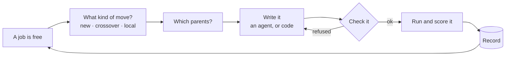

---
hide:
  - navigation
  - toc
---

<div class="evo-hero" markdown>
<div class="evo-hero-text" markdown>

# Optimize the parts of your code you choose.

Mark the code that may change and supply a script that scores one version. Agents propose new versions,
or a built-in optimizer tunes the numbers. evoloop tries them within your budget and keeps a record of
every decision, so you can steer the search while it runs.

[Run the demo](quickstart.md){ .md-button .md-button--primary }
[Set up your own search](setting-up.md){ .md-button }

The demo runs on a laptop in half a minute: no API key, no GPU.
{ .evo-fine }

</div>
<div class="evo-hero-figure" markdown>

**The demo: a toy model search.** 40 small classifiers, each trained once.
{ .evo-caption }

<div class="evo-chart">
<svg xmlns="http://www.w3.org/2000/svg" viewBox="0 0 640 330" role="img" aria-label="The validation accuracy of each model in the built-in example, and the best so far, over 40 models">
<rect width="640" height="330" rx="8" fill="var(--evo-surface)"/>
<line x1="62" y1="284.0" x2="512" y2="284.0" stroke="var(--evo-grid)" stroke-width="1"/>
<text x="54" y="288.0" text-anchor="end" font-size="12" font-family="ui-sans-serif, system-ui, -apple-system, Segoe UI, Roboto, sans-serif" fill="var(--evo-soft)">0.5</text>
<line x1="62" y1="231.2" x2="512" y2="231.2" stroke="var(--evo-grid)" stroke-width="1"/>
<text x="54" y="235.2" text-anchor="end" font-size="12" font-family="ui-sans-serif, system-ui, -apple-system, Segoe UI, Roboto, sans-serif" fill="var(--evo-soft)">0.6</text>
<line x1="62" y1="178.4" x2="512" y2="178.4" stroke="var(--evo-grid)" stroke-width="1"/>
<text x="54" y="182.4" text-anchor="end" font-size="12" font-family="ui-sans-serif, system-ui, -apple-system, Segoe UI, Roboto, sans-serif" fill="var(--evo-soft)">0.7</text>
<line x1="62" y1="125.6" x2="512" y2="125.6" stroke="var(--evo-grid)" stroke-width="1"/>
<text x="54" y="129.6" text-anchor="end" font-size="12" font-family="ui-sans-serif, system-ui, -apple-system, Segoe UI, Roboto, sans-serif" fill="var(--evo-soft)">0.8</text>
<line x1="62" y1="72.8" x2="512" y2="72.8" stroke="var(--evo-grid)" stroke-width="1"/>
<text x="54" y="76.8" text-anchor="end" font-size="12" font-family="ui-sans-serif, system-ui, -apple-system, Segoe UI, Roboto, sans-serif" fill="var(--evo-soft)">0.9</text>
<line x1="62" y1="20.0" x2="512" y2="20.0" stroke="var(--evo-grid)" stroke-width="1"/>
<text x="54" y="24.0" text-anchor="end" font-size="12" font-family="ui-sans-serif, system-ui, -apple-system, Segoe UI, Roboto, sans-serif" fill="var(--evo-soft)">1</text>
<text x="62.0" y="302" text-anchor="middle" font-size="12" font-family="ui-sans-serif, system-ui, -apple-system, Segoe UI, Roboto, sans-serif" fill="var(--evo-soft)">1</text>
<text x="119.7" y="302" text-anchor="middle" font-size="12" font-family="ui-sans-serif, system-ui, -apple-system, Segoe UI, Roboto, sans-serif" fill="var(--evo-soft)">6</text>
<text x="177.4" y="302" text-anchor="middle" font-size="12" font-family="ui-sans-serif, system-ui, -apple-system, Segoe UI, Roboto, sans-serif" fill="var(--evo-soft)">11</text>
<text x="235.1" y="302" text-anchor="middle" font-size="12" font-family="ui-sans-serif, system-ui, -apple-system, Segoe UI, Roboto, sans-serif" fill="var(--evo-soft)">16</text>
<text x="292.8" y="302" text-anchor="middle" font-size="12" font-family="ui-sans-serif, system-ui, -apple-system, Segoe UI, Roboto, sans-serif" fill="var(--evo-soft)">21</text>
<text x="350.5" y="302" text-anchor="middle" font-size="12" font-family="ui-sans-serif, system-ui, -apple-system, Segoe UI, Roboto, sans-serif" fill="var(--evo-soft)">26</text>
<text x="408.2" y="302" text-anchor="middle" font-size="12" font-family="ui-sans-serif, system-ui, -apple-system, Segoe UI, Roboto, sans-serif" fill="var(--evo-soft)">31</text>
<text x="465.8" y="302" text-anchor="middle" font-size="12" font-family="ui-sans-serif, system-ui, -apple-system, Segoe UI, Roboto, sans-serif" fill="var(--evo-soft)">36</text>
<text x="287.0" y="322" text-anchor="middle" font-size="12" font-family="ui-sans-serif, system-ui, -apple-system, Segoe UI, Roboto, sans-serif" fill="var(--evo-soft)">Model iteration</text>
<text transform="translate(16 152.0) rotate(-90)" text-anchor="middle" font-size="12" font-family="ui-sans-serif, system-ui, -apple-system, Segoe UI, Roboto, sans-serif" fill="var(--evo-soft)">Validation accuracy (higher is better)</text>
<line x1="62" y1="284.0" x2="512" y2="284.0" stroke="var(--evo-soft)" stroke-width="1.5" stroke-dasharray="5 4"/>
<path d="M62.0 284.0 H73.5 V262.9 H96.6 V213.6 H108.2 V64.0 H142.8 V42.9 H177.4 V41.1 H212.0 V37.6 H246.6 V35.8 H512.0" fill="none" stroke="var(--evo-series)" stroke-width="2" stroke-linejoin="round"/>
<circle cx="62.0" cy="284.0" r="4" fill="var(--evo-dot)" stroke="var(--evo-surface)" stroke-width="2"><title>Model 1 (C1): 0.5, the baseline</title></circle>
<circle cx="62.0" cy="284.0" r="10" fill="transparent"><title>Model 1 (C1): 0.5, the baseline</title></circle>
<circle cx="73.5" cy="262.9" r="4" fill="var(--evo-dot)" stroke="var(--evo-surface)" stroke-width="2"><title>Model 2 (C2): 0.54, a new design</title></circle>
<circle cx="73.5" cy="262.9" r="10" fill="transparent"><title>Model 2 (C2): 0.54, a new design</title></circle>
<circle cx="85.1" cy="271.7" r="4" fill="var(--evo-dot)" stroke="var(--evo-surface)" stroke-width="2"><title>Model 3 (C3): 0.5233, a new design</title></circle>
<circle cx="85.1" cy="271.7" r="10" fill="transparent"><title>Model 3 (C3): 0.5233, a new design</title></circle>
<circle cx="96.6" cy="213.6" r="4" fill="var(--evo-dot)" stroke="var(--evo-surface)" stroke-width="2"><title>Model 4 (C4): 0.6333, an edit</title></circle>
<circle cx="96.6" cy="213.6" r="10" fill="transparent"><title>Model 4 (C4): 0.6333, an edit</title></circle>
<circle cx="108.2" cy="64.0" r="4" fill="var(--evo-dot)" stroke="var(--evo-surface)" stroke-width="2"><title>Model 5 (C5): 0.9167, a new design</title></circle>
<circle cx="108.2" cy="64.0" r="10" fill="transparent"><title>Model 5 (C5): 0.9167, a new design</title></circle>
<circle cx="119.7" cy="262.9" r="4" fill="var(--evo-dot)" stroke="var(--evo-surface)" stroke-width="2"><title>Model 6 (C6): 0.54, a settings move</title></circle>
<circle cx="119.7" cy="262.9" r="10" fill="transparent"><title>Model 6 (C6): 0.54, a settings move</title></circle>
<circle cx="131.2" cy="213.6" r="4" fill="var(--evo-dot)" stroke="var(--evo-surface)" stroke-width="2"><title>Model 7 (C7): 0.6333, a new design</title></circle>
<circle cx="131.2" cy="213.6" r="10" fill="transparent"><title>Model 7 (C7): 0.6333, a new design</title></circle>
<circle cx="142.8" cy="42.9" r="4" fill="var(--evo-dot)" stroke="var(--evo-surface)" stroke-width="2"><title>Model 8 (C8): 0.9567, an edit</title></circle>
<circle cx="142.8" cy="42.9" r="10" fill="transparent"><title>Model 8 (C8): 0.9567, an edit</title></circle>
<circle cx="154.3" cy="90.4" r="4" fill="var(--evo-dot)" stroke="var(--evo-surface)" stroke-width="2"><title>Model 9 (C9): 0.8667, a new design</title></circle>
<circle cx="154.3" cy="90.4" r="10" fill="transparent"><title>Model 9 (C9): 0.8667, a new design</title></circle>
<circle cx="165.8" cy="208.3" r="4" fill="var(--evo-dot)" stroke="var(--evo-surface)" stroke-width="2"><title>Model 10 (C10): 0.6433, an ablation</title></circle>
<circle cx="165.8" cy="208.3" r="10" fill="transparent"><title>Model 10 (C10): 0.6433, an ablation</title></circle>
<circle cx="177.4" cy="41.1" r="4" fill="var(--evo-dot)" stroke="var(--evo-surface)" stroke-width="2"><title>Model 11 (C11): 0.96, a new design</title></circle>
<circle cx="177.4" cy="41.1" r="10" fill="transparent"><title>Model 11 (C11): 0.96, a new design</title></circle>
<circle cx="188.9" cy="46.4" r="4" fill="var(--evo-dot)" stroke="var(--evo-surface)" stroke-width="2"><title>Model 12 (C12): 0.95, a new design</title></circle>
<circle cx="188.9" cy="46.4" r="10" fill="transparent"><title>Model 12 (C12): 0.95, a new design</title></circle>
<circle cx="200.5" cy="215.4" r="4" fill="var(--evo-dot)" stroke="var(--evo-surface)" stroke-width="2"><title>Model 13 (C13): 0.63, a settings move</title></circle>
<circle cx="200.5" cy="215.4" r="10" fill="transparent"><title>Model 13 (C13): 0.63, a settings move</title></circle>
<circle cx="212.0" cy="37.6" r="4" fill="var(--evo-dot)" stroke="var(--evo-surface)" stroke-width="2"><title>Model 14 (C14): 0.9667, a new design</title></circle>
<circle cx="212.0" cy="37.6" r="10" fill="transparent"><title>Model 14 (C14): 0.9667, a new design</title></circle>
<circle cx="223.5" cy="48.2" r="4" fill="var(--evo-dot)" stroke="var(--evo-surface)" stroke-width="2"><title>Model 15 (C15): 0.9467, an edit</title></circle>
<circle cx="223.5" cy="48.2" r="10" fill="transparent"><title>Model 15 (C15): 0.9467, an edit</title></circle>
<circle cx="235.1" cy="218.9" r="4" fill="var(--evo-dot)" stroke="var(--evo-surface)" stroke-width="2"><title>Model 16 (C16): 0.6233, a new design</title></circle>
<circle cx="235.1" cy="218.9" r="10" fill="transparent"><title>Model 16 (C16): 0.6233, a new design</title></circle>
<circle cx="246.6" cy="35.8" r="4" fill="var(--evo-dot)" stroke="var(--evo-surface)" stroke-width="2"><title>Model 17 (C17): 0.97, an edit</title></circle>
<circle cx="246.6" cy="35.8" r="10" fill="transparent"><title>Model 17 (C17): 0.97, an edit</title></circle>
<circle cx="258.2" cy="99.2" r="4" fill="var(--evo-dot)" stroke="var(--evo-surface)" stroke-width="2"><title>Model 18 (C18): 0.85, a new design</title></circle>
<circle cx="258.2" cy="99.2" r="10" fill="transparent"><title>Model 18 (C18): 0.85, a new design</title></circle>
<circle cx="269.7" cy="37.6" r="4" fill="var(--evo-dot)" stroke="var(--evo-surface)" stroke-width="2"><title>Model 19 (C19): 0.9667, a settings move</title></circle>
<circle cx="269.7" cy="37.6" r="10" fill="transparent"><title>Model 19 (C19): 0.9667, a settings move</title></circle>
<circle cx="281.2" cy="41.1" r="4" fill="var(--evo-dot)" stroke="var(--evo-surface)" stroke-width="2"><title>Model 20 (C20): 0.96, a new design</title></circle>
<circle cx="281.2" cy="41.1" r="10" fill="transparent"><title>Model 20 (C20): 0.96, a new design</title></circle>
<circle cx="292.8" cy="44.6" r="4" fill="var(--evo-dot)" stroke="var(--evo-surface)" stroke-width="2"><title>Model 21 (C21): 0.9533, a new design</title></circle>
<circle cx="292.8" cy="44.6" r="10" fill="transparent"><title>Model 21 (C21): 0.9533, a new design</title></circle>
<circle cx="304.3" cy="48.2" r="4" fill="var(--evo-dot)" stroke="var(--evo-surface)" stroke-width="2"><title>Model 22 (C22): 0.9467, an edit</title></circle>
<circle cx="304.3" cy="48.2" r="10" fill="transparent"><title>Model 22 (C22): 0.9467, an edit</title></circle>
<circle cx="315.8" cy="37.6" r="4" fill="var(--evo-dot)" stroke="var(--evo-surface)" stroke-width="2"><title>Model 23 (C17): 0.9667, a re-check on a new seed</title></circle>
<circle cx="315.8" cy="37.6" r="10" fill="transparent"><title>Model 23 (C17): 0.9667, a re-check on a new seed</title></circle>
<circle cx="327.4" cy="145.0" r="4" fill="var(--evo-dot)" stroke="var(--evo-surface)" stroke-width="2"><title>Model 24 (C23): 0.7633, a new design</title></circle>
<circle cx="327.4" cy="145.0" r="10" fill="transparent"><title>Model 24 (C23): 0.7633, a new design</title></circle>
<circle cx="338.9" cy="49.9" r="4" fill="var(--evo-dot)" stroke="var(--evo-surface)" stroke-width="2"><title>Model 25 (C24): 0.9433, a settings move</title></circle>
<circle cx="338.9" cy="49.9" r="10" fill="transparent"><title>Model 25 (C24): 0.9433, a settings move</title></circle>
<circle cx="350.5" cy="210.1" r="4" fill="var(--evo-dot)" stroke="var(--evo-surface)" stroke-width="2"><title>Model 26 (C25): 0.64, a new design</title></circle>
<circle cx="350.5" cy="210.1" r="10" fill="transparent"><title>Model 26 (C25): 0.64, a new design</title></circle>
<circle cx="362.0" cy="85.1" r="4" fill="var(--evo-dot)" stroke="var(--evo-surface)" stroke-width="2"><title>Model 27 (C26): 0.8767, an ablation</title></circle>
<circle cx="362.0" cy="85.1" r="10" fill="transparent"><title>Model 27 (C26): 0.8767, an ablation</title></circle>
<circle cx="373.5" cy="37.6" r="4" fill="var(--evo-dot)" stroke="var(--evo-surface)" stroke-width="2"><title>Model 28 (C27): 0.9667, an edit</title></circle>
<circle cx="373.5" cy="37.6" r="10" fill="transparent"><title>Model 28 (C27): 0.9667, an edit</title></circle>
<circle cx="385.1" cy="37.6" r="4" fill="var(--evo-dot)" stroke="var(--evo-surface)" stroke-width="2"><title>Model 29 (C28): 0.9667, an edit</title></circle>
<circle cx="385.1" cy="37.6" r="10" fill="transparent"><title>Model 29 (C28): 0.9667, an edit</title></circle>
<circle cx="396.6" cy="42.9" r="4" fill="var(--evo-dot)" stroke="var(--evo-surface)" stroke-width="2"><title>Model 30 (C29): 0.9567, a settings move</title></circle>
<circle cx="396.6" cy="42.9" r="10" fill="transparent"><title>Model 30 (C29): 0.9567, a settings move</title></circle>
<circle cx="408.2" cy="48.2" r="4" fill="var(--evo-dot)" stroke="var(--evo-surface)" stroke-width="2"><title>Model 31 (C30): 0.9467, an edit</title></circle>
<circle cx="408.2" cy="48.2" r="10" fill="transparent"><title>Model 31 (C30): 0.9467, an edit</title></circle>
<circle cx="419.7" cy="69.3" r="4" fill="var(--evo-dot)" stroke="var(--evo-surface)" stroke-width="2"><title>Model 32 (C31): 0.9067, a new design</title></circle>
<circle cx="419.7" cy="69.3" r="10" fill="transparent"><title>Model 32 (C31): 0.9067, a new design</title></circle>
<circle cx="431.2" cy="35.8" r="4" fill="var(--evo-dot)" stroke="var(--evo-surface)" stroke-width="2"><title>Model 33 (C32): 0.97, a settings move</title></circle>
<circle cx="431.2" cy="35.8" r="10" fill="transparent"><title>Model 33 (C32): 0.97, a settings move</title></circle>
<circle cx="442.8" cy="65.8" r="4" fill="var(--evo-dot)" stroke="var(--evo-surface)" stroke-width="2"><title>Model 34 (C33): 0.9133, an ablation</title></circle>
<circle cx="442.8" cy="65.8" r="10" fill="transparent"><title>Model 34 (C33): 0.9133, an ablation</title></circle>
<circle cx="454.3" cy="55.2" r="4" fill="var(--evo-dot)" stroke="var(--evo-surface)" stroke-width="2"><title>Model 35 (C35): 0.9333, an edit</title></circle>
<circle cx="454.3" cy="55.2" r="10" fill="transparent"><title>Model 35 (C35): 0.9333, an edit</title></circle>
<circle cx="465.8" cy="37.6" r="4" fill="var(--evo-dot)" stroke="var(--evo-surface)" stroke-width="2"><title>Model 36 (C36): 0.9667, an edit</title></circle>
<circle cx="465.8" cy="37.6" r="10" fill="transparent"><title>Model 36 (C36): 0.9667, an edit</title></circle>
<circle cx="477.4" cy="129.1" r="4" fill="var(--evo-dot)" stroke="var(--evo-surface)" stroke-width="2"><title>Model 37 (C37): 0.7933, a settings move</title></circle>
<circle cx="477.4" cy="129.1" r="10" fill="transparent"><title>Model 37 (C37): 0.7933, a settings move</title></circle>
<circle cx="488.9" cy="37.6" r="4" fill="var(--evo-dot)" stroke="var(--evo-surface)" stroke-width="2"><title>Model 38 (C38): 0.9667, an edit</title></circle>
<circle cx="488.9" cy="37.6" r="10" fill="transparent"><title>Model 38 (C38): 0.9667, an edit</title></circle>
<circle cx="500.5" cy="37.6" r="4" fill="var(--evo-dot)" stroke="var(--evo-surface)" stroke-width="2"><title>Model 39 (C39): 0.9667, an edit</title></circle>
<circle cx="500.5" cy="37.6" r="10" fill="transparent"><title>Model 39 (C39): 0.9667, an edit</title></circle>
<circle cx="512.0" cy="41.1" r="4" fill="var(--evo-dot)" stroke="var(--evo-surface)" stroke-width="2"><title>Model 40 (C40): 0.96, a settings move</title></circle>
<circle cx="512.0" cy="41.1" r="10" fill="transparent"><title>Model 40 (C40): 0.96, a settings move</title></circle>
<circle cx="512.0" cy="35.8" r="5" fill="var(--evo-series)" stroke="var(--evo-surface)" stroke-width="2"/>
<text x="524" y="276.0" font-size="12" font-family="ui-sans-serif, system-ui, -apple-system, Segoe UI, Roboto, sans-serif" fill="var(--evo-soft)">Baseline</text>
<text x="524" y="293.0" font-size="15" font-weight="600" font-family="ui-sans-serif, system-ui, -apple-system, Segoe UI, Roboto, sans-serif" fill="var(--evo-ink)">0.5</text>
<text x="524" y="51.8" font-size="12" font-family="ui-sans-serif, system-ui, -apple-system, Segoe UI, Roboto, sans-serif" fill="var(--evo-soft)">Selected</text>
<text x="524" y="68.8" font-size="15" font-weight="600" font-family="ui-sans-serif, system-ui, -apple-system, Segoe UI, Roboto, sans-serif" fill="var(--evo-ink)">0.97</text>
<circle cx="316" cy="250" r="4" fill="var(--evo-dot)" stroke="var(--evo-surface)" stroke-width="2"/>
<text x="326" y="254" font-size="12" font-family="ui-sans-serif, system-ui, -apple-system, Segoe UI, Roboto, sans-serif" fill="var(--evo-soft)">each model</text>
<line x1="402" y1="250" x2="422" y2="250" stroke="var(--evo-series)" stroke-width="2"/>
<text x="428" y="254" font-size="12" font-family="ui-sans-serif, system-ui, -apple-system, Segoe UI, Roboto, sans-serif" fill="var(--evo-soft)">best so far</text>
</svg>
</div>

Each point is a model that was really trained. The proposals are scripted here, so this shows how a
search proceeds, not what an agent would find.
{ .evo-fine }

</div>
</div>

!!! note "Where this stands"
    evoloop passes its tests on two built-in examples with scripted proposals. It has not yet been run
    with a real language model on a real training task, and its settings have not been compared against
    each other. [Status and limits](status.md) lists exactly what has been run.

## What you give it, and what it does

You mark what may change. Everything else in your project is frozen.

```python
# EVOLVE-BLOCK-START name=model kind=structure role=network
HIDDEN = []            # no hidden layer: a linear classifier
ACTIVATION = "tanh"

def features(x):
    return x
# EVOLVE-BLOCK-END
```

You supply a script that trains one version and writes its score. Then the search proposes versions of
the block, such as this one from the demo, and runs your script on each:

```python
HIDDEN = [12, 8]
ACTIVATION = "tanh"

def features(x):
    r = np.sqrt((x ** 2).sum(1))
    return np.stack([x[:, 0], x[:, 1], np.sin(6.0 * r), np.cos(6.0 * r)], axis=1)
```

That one scored 0.97 where the original scored 0.50. In between, the search decides what to try next:



An agent only ever returns text. Python chooses what is tried next, enforces the budget and your limits,
and refuses any design that touches code outside the marked blocks.
[One step of a search](how-it-works.md) follows a single design through this loop.

## Three ways in

<div class="grid cards" markdown>

-   **Try it**

    ---

    Run the demo, read its leaderboard, and steer a second run while it goes.

    [Run the demo](quickstart.md)

-   **Use it on your project**

    ---

    Decide which search fits your goal, then set it up, by hand or with a coding agent.

    [Which search should I run?](which-search.md) · [Set up your search](setting-up.md)

-   **Understand it**

    ---

    How designs are chosen, written and compared, with figures you can change.

    [One step of a search](how-it-works.md) · [Who becomes a parent](parents.md)

</div>

## You make five decisions; an agent can do the rest

evoloop has many settings, and you are not meant to work through them. It is built to be set up with a
coding agent. Open the repository in Claude Code, or another agent that can read files and run commands,
and say "set up an evoloop search for my project". The agent marks the blocks, writes the scoring
script, proposes an answer to each question with its reason, and asks you only what it cannot work out.
Nothing runs until you have read the plan and confirmed it.

What is yours to decide:

1. **What to optimize.** A better score, a smaller model, tuned settings and a faster algorithm are
   different searches. [Which search should I run?](which-search.md)
2. **What may change.** The search only touches the blocks you mark.
3. **How a design is scored**, and how much that score varies between two runs of the same design.
4. **How much to spend**, in training runs and in agent dollars. Both are caps.
5. **Hard limits**, if you have any: the largest or slowest model you would accept.

Everything else has a default that follows from those answers, and can be changed while the search
runs.

## Find your way around

| | |
|---|---|
| **Start** | [Run the demo](quickstart.md) · [Set up your search](setting-up.md) · [Write the evaluator](evaluator.md) · [Measure your noise](noise.md) · [Run on a cluster](servers.md) |
| **Choose a search** | [Which search should I run?](which-search.md) · the twelve goal guides · [Edit or write a skill](skills.md) |
| **Concepts** | [One step of a search](how-it-works.md) · [What gets tried next](schedule.md) · [Who becomes a parent](parents.md) · [Edits, crossover and settings moves](moves.md) · [Cheaper evaluations](early-stopping.md) · [When two scores can be compared](comparable.md) · [The agents](agents.md) · [Compared with FunSearch and AlphaEvolve](compared.md) |
| **Run and steer** | [Watch and steer a run](steering.md) · [Budget and cost](cost.md) · [Working with the strategist](strategist.md) · [Audit the agents](auditing.md) · [Save and deposit the study](study.md) |
| **Reference** | [Commands](commands.md) · [Brief fields](fields.md) · [Options and presets](menu.md) · [Evaluator interface](project-contract.md) · [Skill file format](skill-format.md) · [Files of a run](records.md) · [Skill library](skill-library.md) · [Models and prices](models.md) · [Glossary](glossary.md) · [Status and limits](status.md) |
