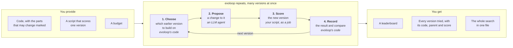

---
hide:
  - navigation
---

# evoloop

**evoloop improves code you can score.** You mark the parts of your code that may change and write a
script that measures how good one version is. evoloop then runs an evolutionary search: LLM agents
propose changes, your script scores each one, and the results decide what is tried next.

Use it to raise a model's validation score, train a smaller student from a teacher, tune
hyperparameters, or make an algorithm or pipeline faster while its output stays the same.

[Set up a search](setting-up.md){ .md-button .md-button--primary }
[Explore the search options](options.md){ .md-button }
[Source on GitHub](https://github.com/cameo-db/evoloop){ .md-button }

Agents write the changes. Code does everything that must be trusted: it picks what to build on, checks
that only the marked parts changed, runs the jobs, enforces the budget and your limits, and keeps the
record. The search runs on a laptop or on a Slurm cluster.

## Three ways to run it

evoloop is a Python package with a command line. You can drive it at whichever level you like.

| | What you do |
|---|---|
| **Let an agent run it** | Open the repository in Claude Code or another coding agent and say what you want to improve. The agent asks you the setup questions one at a time, marks the code and writes the scoring script with you, shows you the plan, and starts the search when you confirm. It follows [AGENTS.md](https://github.com/cameo-db/evoloop/blob/main/AGENTS.md). |
| **Answer the questions yourself** | `evoloop setup` asks the same questions in the terminal. `evoloop form` gives them as a web page. [Set up a search](setting-up.md). |
| **Edit the files** | Everything is a plain file you can open and change: the brief (`brief.yaml`), the task description the agents read, and the skill files. [Brief fields](fields.md) · [Commands](commands.md). |

Every search starts the same way, whichever you choose: a short list of questions, a plan that states
what will run and what it is likely to cost, and your confirmation. Nothing is spent before you confirm.
While it runs you can change settings, send the agents a note, or stop it.
[Monitor and steer a search](steering.md).

## What you decide

Each step of the loop has one choice that matters. Everything else has a default.

| Step | The choice | Your options |
|---|---|---|
| 1. Choose | Which earlier versions get another try? | Five search strategies, below. [Parent selection](parents.md) |
| 2. Propose | How much do the agents decide? | From `harnessed` (code plans every move, the agent only writes it) to `agentic` (agents also choose the moves and adjust the schedule). A search over hyperparameters alone can use a built-in Bayesian optimizer with no agent. [Agents](agents.md) |
| 3. Score | What does your script measure, and does every version run to the end? | Your own metric. Optionally stop weak versions part way. [Write the evaluator](evaluator.md) · [Early stopping](early-stopping.md) |
| 4. Record | How much may be spent, and what is out of bounds? | A number of evaluations, a dollar cap for the agents, and limits such as a largest model size. [Budget and cost](cost.md) |

A **run type** sets these choices together for a way of spending the budget, such as exploring first and
refining later. [Choose a skill and a run type](which-search.md).

## Search strategies

The strategy decides which versions are built on. Each follows a known method.

| Strategy | Builds on | Known as |
|---|---|---|
| `lineage` (default) | the best version of each of several families, so a slow starter is not crowded out | speciation, as in NEAT |
| `archive` | the best version in each cell of a grid, such as each size band | MAP-Elites; with islands, AlphaEvolve's program database |
| `tournament` | the best of a few drawn from the most recent versions | regularized evolution |
| `pareto` | versions not beaten on both the score and a second measure, such as size | non-dominated sorting, as in NSGA-II |
| `greedy` | the single best version | hill climbing |

Any strategy can run as separate populations that are restarted from the best one, as in FunSearch.
[How evoloop compares with FunSearch and AlphaEvolve](compared.md).

## Skills

A skill is optional. It is a file that adapts the general search to one goal, such as distillation or a
faster algorithm: it sets the choices above and gives the agents guidance for that goal. Without one you
supply that guidance yourself in the task description.

The library has thirteen. During setup you can read the one you chose, edit it, or merge several into
one file. [Choose a skill](which-search.md) · [Edit, merge or write a skill](skills.md)

## Read next

| To | Read |
|---|---|
| start on your own project | [Set up a search](setting-up.md) · [Write the evaluator](evaluator.md) · [Run on a cluster](servers.md) |
| understand the loop | [How it works](how-it-works.md) · [Search options on one page](options.md) |
| see it run on a toy problem | [Worked example](quickstart.md) |
| look something up | [Reference](reference.md) |

Version 0.2. evoloop passes its tests with a script standing in for the LLM. It has not yet been run
with a real LLM on a real training task. [Status and limits](status.md).
