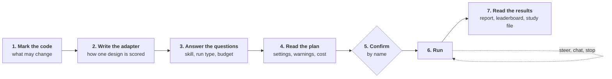
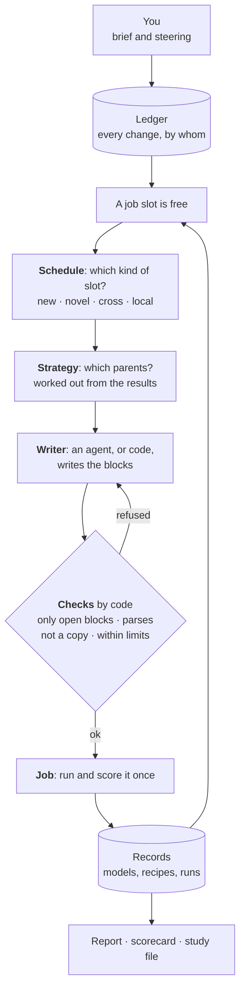
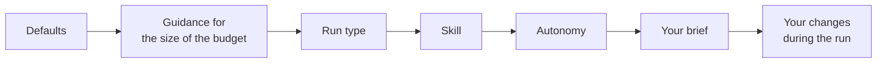

# evoloop

evoloop improves a project's code by evolutionary search. You mark the parts of the code that may
change. Language-model agents write new versions of those parts. Code decides what gets tried next,
runs each design once, keeps the score, and records everything.

It is built for searches where one evaluation is costly, such as a training run: tens to hundreds of
evaluations, with scores that differ between two runs of the same design. You can change its course
while it runs.

## The workflow



??? note "1. Mark the code"
    `evoloop init mysearch --source path/to/project` copies your project into a search folder. In the
    copy, you put markers around the parts that may change:

    ```python
    # EVOLVE-BLOCK-START name=trunk kind=structure role=trunk
    ...the code of the trunk...
    # EVOLVE-BLOCK-END
    ```

    Everything outside the markers is frozen and checked on every start. Your original project is never
    touched. Details: [Setting up a search](setting-up.md).

??? note "2. Write the adapter"
    `adapter/run.py` runs one design and writes `result.json` with its score. It can also report a
    size, a speed, where the errors fall, and progress lines that let weak designs be stopped early.
    Details: [The project's code](project-contract.md).

??? note "3. Answer the questions"
    One question at a time, with choices and a suggested answer where there is evidence for one: in a
    terminal (`evoloop setup`), in a browser form (`evoloop form`), or with an agent in a chat. Two
    answers decide most of the rest: the [skill](skills.md) (what kind of problem this is) and the run
    type (how to search).

??? note "4. Read the plan"
    `evoloop plan mysearch` shows every setting and where its value came from, warnings about
    combinations that work against each other, and an estimate of what the agents will cost.

??? note "5. Confirm"
    `evoloop brief mysearch --confirm "Your Name"`. Nothing runs before this. The skills you chose are
    copied into the search folder, where you can edit them.

??? note "6. Run, and steer"
    `evoloop run mysearch --name r1`, on your machine or with one Slurm job per design. While it runs you
    can change settings, add notes for the agents, order particular moves, switch skills, or talk to the
    agent that runs the search. Every change is checked and recorded. Details:
    [Steering a run](steering.md).

??? note "7. Read the results"
    A report with the leaderboard, what each kind of move returned and what waits for you; every design
    with its code and history; a ledger of every change; a scorecard of the agents; and a study file in
    the CAMEO entry format. Details: [Records and the study file](records.md).

## What happens for each design



Three rules hold everywhere:

- **Agents write and judge; code decides and records.** Whatever an agent returns is checked by code
  before it counts. The budget, the limits and the frozen code are enforced by code, never by a prompt.
- **Agents never talk to each other.** Each call is a fresh context built from the run's records, so a
  search can stop, restart, or change its agents at any point.
- **A guess is only ever a suggestion.** The tool proposes answers with reasons; you see every one and
  can change it.

## The two choices that decide most of the rest

| Choice | It says | Options |
|---|---|---|
| **Skill** (`run.skill`) | what kind of problem this is | a [library](skill-library.md) of templates you can edit, combine and add to |
| **Run type** (`run.type`) | how to search | `explore_then_exploit`, `refine`, `survey`, `discovery`, `settings_only`, `custom` |

??? note "The skills"
    | Skill | For |
    |---|---|
    | `model-performance` | the best score, nothing else weighed |
    | `model-distillation` | a smaller or faster student that matches a teacher |
    | `model-efficiency` | the same score at a lower cost in parameters or time |
    | `model-size-frontier` | the best model at every size or speed across a broad range |
    | `model-training-recipe` | a better score from the same architecture, by training it better |
    | `model-ensemble-members` | a set of strong models whose errors do not coincide |
    | `model-finetuning` | the best score on a task starting from a pretrained model |
    | `model-mechanistic` | a better fit without losing what the parameters mean |
    | `settings-tuning` | the best values for the settings of fixed code, by a Bayesian estimator, with no agent calls |
    | `algorithm-runtime` | the same results in less time or memory |
    | `bioinformatics-algorithm` | better accuracy against a truth set, at an acceptable run time |
    | `data-pipeline` | the same output from a pipeline in less time, memory or cost |

    A skill sets what suits the task, gives each agent guidance for its role, and says what your adapter
    must report. Skills can be combined (`run.skill: [model-distillation, model-size-frontier]`).
    [Skills](skills.md) explains them; the [skill library](skill-library.md) shows each in full.

??? note "The run types"
    | Run type | For | Shares of new designs, crossover, local moves |
    |---|---|---|
    | `explore_then_exploit` | most searches | 65 / 10 / 25 for the first 60% of the budget, then 15 / 25 / 60 |
    | `refine` | a known good model | 10 / 20 / 70 throughout; few families |
    | `survey` | a new problem | 75 / 10 / 15 throughout; each kind of design kept in play |
    | `discovery` | long runs with cheap evaluations | novelty high, the lightest harness |
    | `settings_only` | a hyperparameter search | every slot is a settings move |
    | `custom` | your own description | where you set nothing, the guidance for the budget and the defaults |

    The [menu](menu.md) lists exactly what each sets.

## How a choice changes what the search does

Every choice moves the search along a few axes. This is the short version;
[How each choice changes the search](choices.md) goes through all of them.

| If you want | Change | Effect |
|---|---|---|
| more exploration | the share of new designs in `schedule.phases`; `schedule.novelty` up; `survey` | more families tried, each less deeply |
| more exploitation | the share of local moves up; `refine`; `strategy.mechanism: greedy` | the leader improved faster, at the risk of a local optimum |
| different kinds of design kept alive | `strategy.mechanism: archive` or `lineage`; islands | a design that is different but behind stays in play |
| two goals at once | `strategy.mechanism: pareto` with `strategy.second_metric` | a trade-off front instead of one winner |
| more designs for the same compute | `evaluation.ladder` | weak designs stopped early; slow starters can be lost |
| a lower agent bill | `harness.level: minimal`; a cheaper model; `variation.settings_by: tpe` | fewer or cheaper calls, less judgement |
| more judgement from the agents | `harness.autonomy: agentic`; `strategist.mode: act`; `harness.conductor: agent` | the course adapts to the results, within bounds you set |

## Where each setting's value comes from



A later layer wins over an earlier one, so what you set yourself always stands. `evoloop plan` prints
every setting with the layer it came from.

## Where to go next

| To | Read |
|---|---|
| see it work, at no cost | [First run](quickstart.md) |
| set up your own search | [Setting up a search](setting-up.md), [Skills](skills.md), [The project's code](project-contract.md) |
| decide between options | [How each choice changes the search](choices.md), [Menu of choices and presets](menu.md) |
| understand the mechanisms | [How a search works](how-it-works.md), [How it compares with established methods](compared.md) |
| run and steer | [Steering a run](steering.md), [The strategist and the budget](strategist.md), [Commands](commands.md) |
| choose models and autonomy | [Model and effort](models.md), [Agentic or harnessed, and what it costs](autonomy.md) |
| check the agents and the results | [Auditing the agents](auditing.md), [Records and the study file](records.md) |
| know what is proven | [Status and limits](status.md) |
