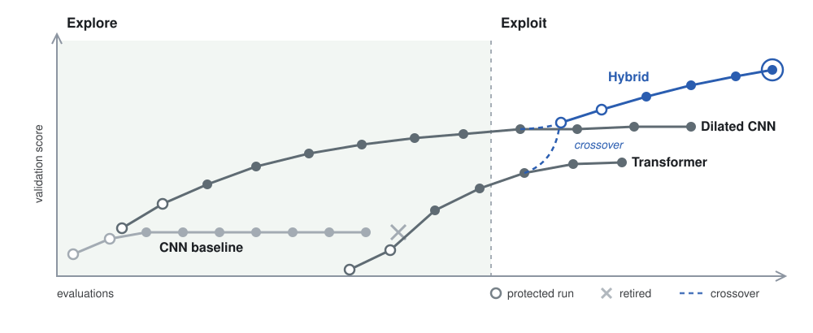

# Parent selection

A local move needs one parent and a crossover needs two. The *strategy* is the rule that chooses
them, and so decides which earlier designs get built on.

| Strategy | Parents come from | Known as | Use it when |
|---|---|---|---|
| `lineage` (default) | the best design of each of several lineages | speciation with protected niches, as in NEAT | you have no reason to choose another |
| `archive` | the best design in each cell of a grid | MAP-Elites; with islands, AlphaEvolve's program database | you want different kinds of design, not one winner |
| `tournament` | the best of 3 drawn from the 24 most recent designs | regularized evolution (Real et al. 2019) | the budget is several hundred and scores are noisy |
| `pareto` | designs not beaten on both the score and a second metric | non-dominated sorting, as in NSGA-II | you care about score and size or speed together |
| `greedy` | the single best design | hill climbing | the budget is about 30 |

## Interactive comparison

Change the parent rule or move a slider and the search below reruns. The figure is a toy. Every
possible design is laid out on a line, with similar designs close together, and a curve gives the true
quality of each. The baseline starts on a low hill, and the highest hill is narrow and somewhere else.
"Another landscape" draws a different set of hills. The search cannot see the curve. It can only try a
design and get a noisy score.

<div class="evo-widget" id="evo-playground">The playground needs JavaScript.</div>

Each dot is a design that was tried. A new design lands anywhere, a local move lands near its parent,
and a crossover lands between two parents.

- With greedy and 10% new designs, the search climbs the hill it started on and mostly stays there.
- Raise new designs to 40% and the high peak is usually found, with fewer evaluations left to climb it.
- With lineage or archive, a design on another hill is built on even while it is behind, so a better
  peak gets climbed once it is found.
- Turn the noise up and greedy starts chasing lucky scores.

The outcome depends on the landscape. On some, greedy ends highest, because a new design happened to
land near the top. A real design space is not a line and a real evaluation takes hours, so the toy
says nothing about which strategy is best for your problem. It shows what each one does with a fixed
budget.

## Lineage

A lineage is one founding design and everything derived from it. The default strategy keeps several
lineages going side by side.



A lineage is founded by a new design or by a crossover. Its first two evaluations are a protected
trial: it receives local moves ahead of everything else and is not compared with other lineages, so a
transformer that starts badly is not dropped after one result.

After the trial, the best-ranked lineages are active and receive local moves: up to eight by default,
six at a budget of 100 evaluations. The rest wait on the bench, where they can still be one parent of a
crossover.

Two rules stop one lineage from taking over. No lineage gets more than 40% of the local moves. And a
lineage that goes six local moves in a row without a gain larger than the noise is retired to the
bench.

Among the active lineages, better-ranked ones are chosen more often, and ones that have been built on
less are favoured. Within a lineage the parent is its best design, or any design tied with it within
the noise.

Settings: `population.trial_runs` (2), `population.lineages` (8, fewer at small budgets),
`population.quota` (0.4), `population.retire_after` (6), `population.tie_margin`.

## Archive

The archive keeps the best design of each kind, so that different designs stay in play.

Every scored design falls into a cell. By default a cell is a family label and a size band. The family
is the name the writer gave that kind of design, and each size band is a fourfold step in parameter
count, so a 100k-parameter CNN and a 2M-parameter CNN are in different cells. Each cell keeps its best
design, and parents are drawn from those.

`schedule.novelty` decides which cell is drawn from. At 0 the best-ranked cells are chosen most. At 1
the cells that have been built on least are. In between, both count.

Choose the archive when coverage is the point: a new problem, the best design at each size, or models
that fail differently. `strategy.descriptors` sets what a cell is: `family`, `size`, `behaviour`, or
any metric your evaluator reports.

## Tournament

The population is the 24 most recent scored designs. For each parent, three are drawn at random and
the best is taken. A design older than the window leaves the population however good it was, so one
lucky score cannot lead for long. This is regularized evolution, the method with the longest record in
architecture search. It suits larger budgets.

Settings: `strategy.window` (24), `strategy.tournament_size` (3).

## Pareto

Pareto selection is for two goals at once: the score, and a second metric such as size or speed.

A design is on the front when no other design is at least as good on both and better on one. Take
three designs: 0.92 at 5M parameters, 0.90 at 1M, and 0.85 at 2M. The first two are on the front. The
third is not, because the second beats it on both.

Parents are drawn from the front. A crossover pairs designs from opposite ends, a small one with an
accurate one. A difference in score smaller than the noise does not push a design off the front, and a
design that reports no value for the second metric counts as worst on it.

The leaderboard is still ranked by score alone.

Settings: `strategy.second_metric` (`parameters`, `examples_per_s`, `training_minutes`, or a metric
you report), `strategy.second_direction`.

## Greedy

Local moves go to the best design, or to one tied with it within the noise. Crossover pairs the best
with the design whose errors differ most from its own. New designs are still made at the rate the
schedule sets, but they have to beat the leader to be built on. With about 30 evaluations there is no
room for a population, and greedy is what the defaults for small budgets choose.

## Islands

Any strategy can run as several separate populations. With `strategy.islands: 3`, each slot goes to
the island with the fewest designs, and that island sees only its own results, so the islands are not
all pulled toward one leader. Every 12 scored designs, an island takes the best design of another as
a parent.

Islands split the budget: three islands on 100 evaluations get about 33 each. Use them from a few
hundred evaluations up.

With `strategy.reset_every: 40`, every 40 scored designs the weaker half of the islands start again
from the best design of an island that was kept, as FunSearch does. What they held stays in the
records and on the leaderboard.

## Changing the strategy

A [skill](which-search.md) sets the strategy that suits its goal. You can also change it during a
search:

```
evoloop set mysearch --name r1 strategy.mechanism=archive --by "Your Name"
```

A strategy keeps no state of its own, so the new one takes over from the same results.
