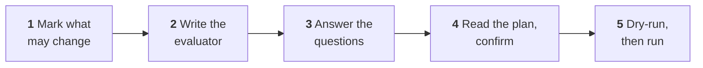

# Set up a search

Five steps take a project to a running search. A coding agent can do most of them with you; the steps
are the same either way, and this page is also how to check what an agent did.



## With an agent

Open the evoloop repository in Claude Code, or another agent that can read files and run commands, point
it at your project, and ask it to set up a search. It follows
[AGENTS.md](https://github.com/cameo-db/evoloop/blob/main/AGENTS.md): it proposes which code to mark,
writes the evaluator, suggests an answer to each question with its reason, and asks you only what it
cannot work out.

Five decisions are yours whoever does the typing: what to optimize, what may change, how a design is
scored and how noisy that score is, how much to spend, and any hard limits. The rest have defaults.

## Before you start

```
evoloop init mysearch --source path/to/project
```

copies your project into a search folder. Your original is never touched.

| In `mysearch/` | What it is |
|---|---|
| `base/` | the copy of your code, where you mark what may change |
| `adapter/run.py` | the evaluator: trains one design and writes its score |
| `task.md` | what the agents are told about the problem |
| `brief.yaml` | the answers that set up the search |

## 1. Mark what may change

In `base/`, put a pair of comment lines around each part that may change:

```python
# EVOLVE-BLOCK-START name=trunk kind=structure role=trunk
class Trunk(nn.Module):
    ...
# EVOLVE-BLOCK-END

# EVOLVE-BLOCK-START name=fit kind=params role=optimizer
PARAMS = {"lr": 3e-4, "batch_size": 128}
# EVOLVE-BLOCK-END
```

A `structure` block is code an agent rewrites. A `params` block is one dictionary of settings, which
code can also change. The `role` is your own word for the part: `trunk`, `head`, `loss`, `optimizer`,
`augmentation`.

Mark generously, once. The brief then says which roles are open in a given search, so the same
marked-up project serves a search over settings only, over one module, or over the whole architecture.
Marking the trunk and the head as separate blocks also lets a crossover combine the trunk of one design
with the head of another.

Everything outside the markers is frozen. evoloop checks it on every start and will not continue if it
changed.

## 2. Write the evaluator

`adapter/run.py` trains one design and writes `result.json` with its score. `evoloop init` writes a
template; [Write the evaluator](evaluator.md) has a complete example and how to test it by hand.

Then write `task.md`: a page telling the agents what the problem is, what the data looks like, what the
score means, and anything you already know works or does not. They read it on every call and see
nothing else of your project except the marked blocks.

## 3. Answer the questions

```
evoloop setup mysearch
```

asks one question at a time, with choices, a suggested answer where there is evidence for one, and where
you are in the list. Up to twenty questions; most have a default you can accept with Enter. Ten have no
default and must be answered:

| Question | What to know |
|---|---|
| What is being improved, and why? | one or two sentences; every agent reads them |
| Is a higher score better, or a lower one? | |
| How should the search spend its evaluations? | the run type: [Choose a skill and a run type](which-search.md) |
| How many designs may be trained in all? | the budget, in evaluations |
| How long is one training run? | in your evaluator's own unit: epochs, steps |
| How much does the score vary between two runs of the same design? | [Measure your noise](noise.md) |
| Train the baseline, import its score, or skip it? | training it inside the search is the usual choice |
| How many designs may train at once? | |
| Which agent backend? | the Anthropic API, Claude Code, or scripted proposals for a dry run |
| What is the most the agents may cost? | a cap, in dollars |

There are other ways to answer the same questions. `evoloop form mysearch` writes a self-contained web
page to fill in; save the answers file it gives you and run `evoloop brief mysearch --import
PATH/TO/answers.json`. Or edit `brief.yaml` directly: [Brief fields](fields.md) lists every field.

### The skill, if you chose one

Choosing a skill copies its file to `mysearch/skills/NAME/skill.yaml`. That copy is what the search
reads. `evoloop setup` shows what it sets and offers to open it in your editor (`e`) or, with several
skills, to merge them into one file (`m`). The form shows each chosen skill as an editable text box.
Change the settings or the text the agents are given, then read the plan: it shows the effect.
[Edit, merge or write a skill](skills.md).

## 4. Read the plan, then confirm

```
evoloop plan mysearch
```

The plan opens with what the search will actually do. For example:

```
At a glance
  Optimizing:      explore_then_exploit, skill model-performance
  Designs:         written by an agent; settings moves by an agent
  Agents:          writer (about 109 calls), analyst (about 13 calls), strategist (about 10 calls)
  Model:           claude-opus-5-5, effort medium
  Selection:       lineage
  Runs on:         Slurm, one job per design, partition gpu, 8 at once (site file: our-cluster)
  Early stopping:  new designs screened at 50%, the best 50% go on
  Budget:          100 evaluations of 30 epochs; agents capped at $40
```

Then come warnings about choices that work against each other, an estimate of what the agents will
cost, and every setting with where its value came from. Read the first block and the warnings; the long
list is for looking things up.

When it says what you want:

```
evoloop brief mysearch --confirm "Your Name"
```

Nothing runs before this. Your name and a digest of what you agreed to are recorded, and a brief that
is edited afterwards has to be confirmed again.

## 5. Dry-run, then run

First prove the plumbing with scripted proposals and a tiny budget, which costs nothing:

```
evoloop brief mysearch --answer agents.backend=stub --answer budget.evaluations=4 --confirm "Your Name"
evoloop run mysearch --name dry
```

If four designs train and a report appears, set the real backend and budget, confirm again, and run:

```
evoloop run mysearch --name r1
```

On a cluster, each design is its own job, and the search itself can run as a small job too.
[Run on a cluster](servers.md) covers describing your machine once so that every search uses it.

## Where a setting gets its value

You answer a few questions and evoloop fills in the rest, from the first of these that has a value:

1. a change you made while the search was running;
2. the brief;
3. the skill;
4. the level of autonomy;
5. the run type;
6. the guidance for the size of your budget;
7. the default.

`evoloop plan` shows which of these each value came from.

## Next

[Watch and steer a run](steering.md) once it is going.
