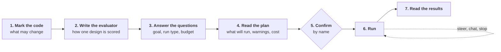

# Setting up a search



## With an agent, or by hand

You do not have to do the steps below yourself. evoloop is built to be set up **with a coding agent**: open the
repository in Claude Code (or another agent that can read files and run commands), point it at your project, and
ask it to set up a search. It follows [AGENTS.md](https://github.com/cameo-db/evoloop/blob/main/AGENTS.md): it marks
the blocks, writes the evaluator, proposes an answer to each question with its reason, and asks you only what it
cannot work out. You confirm the plan by name before anything runs.

Five decisions are yours, whoever does the typing: **what to optimize**, **what may change**, **how a design is
scored** (and how noisy that score is), **how much to spend**, and any **hard limits**. Everything else has a default
that follows from those; leave it alone until a result gives you a reason. This page is the same procedure written
out, for doing it by hand or for checking what the agent did.

Not sure which kind of search you need? Start from [what you want to optimize](guides/index.md): each
goal has a starting configuration you can paste into the brief.

```
evoloop init mysearch --source path/to/project
```

makes a search folder:

| In the folder | What it is |
|---|---|
| `brief.yaml` | the form that sets up the search |
| `task.md` | what the agents are told about the problem |
| `base/` | a snapshot of your code, where you mark what may change |
| `adapter/run.py` | how one design is trained and scored |

Your original code is never touched: the search works on the snapshot.

## 1. Mark the code

In `base/`, put comment lines around what may change, and say what part of the system each block is:

```python
# EVOLVE-BLOCK-START name=trunk kind=structure role=trunk
class Trunk(nn.Module):
    ...
# EVOLVE-BLOCK-END

# EVOLVE-BLOCK-START name=fit kind=params role=optimizer
PARAMS = {"lr": 3e-4, "batch_size": 128}
# EVOLVE-BLOCK-END
```

- `kind=structure` is code an agent rewrites.
- `kind=params` is exactly one assignment of a dict of numbers, booleans or strings.
- `role` is your own word for the part: `stem`, `trunk`, `heads`, `loss`, `optimizer`,
  `augmentation`. It defaults to `model` for structure and `settings` for params.

Mark the code once. The brief then says which roles are open in a given run (`space.preset`,
`space.roles`), so one marked-up project serves a settings search, a search over one module, and an
open architecture search. Blocks whose role is in `space.recipe_roles` make up the training recipe;
the other structure blocks make up the model.

Several blocks by role are worth the trouble: the `block_swap` crossover can then move the trunk of one
design onto the heads of another without an agent.

Everything outside the markers is frozen and checked by hash. A run refuses to go on if `base/` or
`adapter/` changed after it started.

## 2. Write `task.md` and the adapter

`task.md` says what the problem is, what each block is for, and what a good solution looks like.
Agents see it, the open blocks and the visible results, and nothing else of your code.

`adapter/run.py` trains one design and writes its result. See [The project's code](project-contract.md).

## 3. Fill in the brief

One list of questions, and four ways to answer it. All of them ask the same questions in the same
order, by section, and say where you are: "question 6 of 17, Budget".

| Way | Command | For |
|---|---|---|
| In the terminal | `evoloop setup mysearch` | one question at a time; numbered choices; Enter accepts what is shown; `b` goes back; `q` saves and stops |
| In a browser | `evoloop form mysearch` | writes `setup_form.html`, a self-contained page with no server; it ends with an answers file |
| In a chat with an agent | `evoloop brief mysearch --next` | the next question as JSON; the agent asks it, one at a time, with its choices |
| By hand | edit `brief.yaml` | every field is in [Fields of the brief](fields.md) |

**The form.** Open `setup_form.html` in any browser; if the search folder is on a server, copy the file
to your own machine first. It shows one section at a time with a count of what is done, and the last
step gives you an answers file. Save that as `answers.json` and give its path:

```
evoloop brief mysearch --import mysearch/answers.json
```

Nothing is sent anywhere by the page; a draft is kept only in that browser.

**Suggestions.** You are not asked cold. Before the questions, the tool proposes a best guess where it
has evidence, each with its reason, and shows it preselected:

- from the machine: Slurm or not, how many GPUs, which agent login is present;
- from the folder: what the marked code allows to change, a direction of the score stated in `task.md`;
- from your answers so far: the kind of search for the size of the budget, a spend cap from the estimate.

An agent helping you does the same from what it has read (`evoloop brief mysearch --suggest
FIELD=VALUE --because "..."`). A suggestion is never an answer by itself: it becomes one when you leave
it or pick it, and you can always choose something else. Nothing is suggested where there is no
evidence (the goal, the length of a run, the noise of the score); those are asked plainly.

**What is asked.** Up to twenty questions; 14 to 19 usually apply (the model is not asked for
with the stub, the Slurm partition not on one machine). Ten have no default and need an answer:

| Field | Question |
|---|---|
| `objective.goal` | What is being improved, and why? |
| `objective.direction` | Is a higher score better, or a lower one? |
| `budget.evaluations` | How many models may be trained in all? |
| `run.type` | What kind of search? |
| `evaluation.allowance` | How long is one training run? |
| `evaluation.noise` | How much does the score differ between two fits of the same model? |
| `baseline.mode` | Train the baseline, import a finished fit, or skip it? |
| `compute.gpus` | How many models may train at once? |
| `agents.backend` | Which agent backend? |
| `budget.model_dollars` | What is the most the agents may cost? (not asked with the stub) |

The others (what may change, agentic or harnessed, the model, the effort, the reviews) have defaults
you can leave. Every other field of the brief takes its value from the first of these that gives one:

1. your changes during the run
2. the brief (what you set)
3. the skill
4. the level of autonomy
5. the run type
6. the guidance for the size of the budget
7. the default

[Fields of the brief](fields.md) lists them all. `evoloop menu` prints the choices and the presets.

With `run.type: custom`, describe the search in `run.description`; where you set nothing, the guidance
and the defaults apply, and your description is kept as the first note the agents read.
**The kind of optimisation.** Beside the kind of search, setup asks what kind of problem this is (`run.skill`):
raising a score, distilling a student, tuning settings, making a model or an algorithm smaller or faster, or improving an
interpretable model. It suggests one from the words of your goal, and you can combine several. When you confirm,
the skills you chose are copied into the search's `skills/` folder, where you can edit them. See [Skills](skills.md)
and the [skill library](skill-library.md).


## 4. Read the plan and confirm

```
evoloop plan mysearch
```

The plan leads with what the search will actually do, so that a preset cannot quietly change it (abridged here):

```
At a glance
  Optimising:      settings_only, skill settings-tuning
  Designs:         settings only; every move is made by a Bayesian estimator in code (tpe; no agent call)
  Agents:          none: this search calls no agent
  Selection:       greedy
  Early stopping:  new designs screened at 50%, the best 50% go on
  Budget:          60 evaluations of 10 steps; agents capped at $20
  Kept:            variation.settings_by stays 'tpe' as the skill settings-tuning sets it; the autonomy guided asks for 'agent'
```

- **Designs** and **Agents** say who writes the designs and which agent roles will be called, with about how
  many calls each.
- **Kept** and **Changed** lines say where one of your choices overrode another: a skill's setting that a level
  of autonomy asked to change (the skill's stands), or one you set yourself (yours stands).
- Then come the warnings about choices that work against each other, the estimate of what the agents will cost,
  and every setting grouped by where its value came from. A warning never stops a run.


```
evoloop brief mysearch --confirm "Your Name"
```

records your agreement and a digest of what you agreed to. A run does not start on a brief that was
changed after it was confirmed.

## Guidance by size of budget

`evoloop guide 100` prints it for one size; the [menu](menu.md#budget-guidance) has the whole table.

| | about 30 | about 100 | about 300 | 1,000 or more |
|---|---|---|---|---|
| Suggested strategy | greedy | lineage | lineage | archive |
| Lineages kept | 3 | 6 | 10 | (cells) |
| Runs per new lineage | 1 | 2 | 2 | 2 |
| Crossover kinds | graft | graft, hybrid | all three | all three |
| Novel share of new designs | 0 | 0.15 | 0.33 | 0.33 |
| Proposals per slot | 4 | 3 | 2 | 1 |
| Reviews | end | halfway | quarterly | on demand |

A named run type keeps its own strategy; when the guidance suggests another, the plan says so. These
are rules of thumb, not measurements.

## 5. Dry-run, then run

Set `agents.backend: stub` and run a few models first: it shows that the adapter, the markers and the
job settings work before any agent is paid. Then:

```
evoloop run mysearch --name r1
```

The same command continues a run that was stopped.
