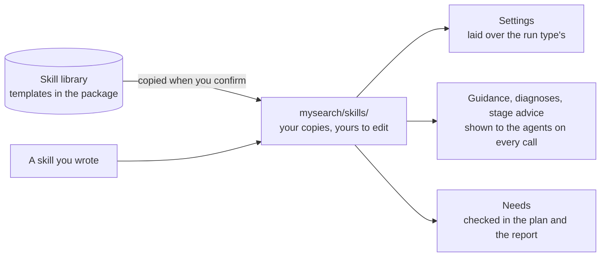

# Skills: the kind of optimisation

Two choices set up a search, and they are independent.

- The **run type** says *how to search*: the strategy, the schedule, the harness.
- The **skill** says *what kind of problem it is*: what may change, how designs are selected, what the
  agents should know about this kind of task, and what the adapter and the leaderboard need for it.

Raising a score, distilling a student, tuning settings, shrinking a model, speeding up an algorithm and
improving an interpretable model are different jobs. A writer that is good at one needs different
advice for another, and the right selection rule differs too.

```yaml
run:
  type: explore_then_exploit
  skill: model-distillation
```



## The library

The skills that come with evoloop are a library of templates. The [skill library](skill-library.md)
page shows each in full; `evoloop skills` lists them and `evoloop skills --search WORDS` finds them by
what they are for.

| Domain | Skills |
|---|---|
| Models | `model-performance`, `model-distillation`, `model-efficiency`, `model-size-frontier`, `model-training-recipe`, `model-ensemble-members`, `model-finetuning`, `model-mechanistic` |
| Settings | `settings-tuning` |
| Algorithms | `algorithm-runtime` |
| Bioinformatics | `bioinformatics-algorithm` |
| Pipelines | `data-pipeline` |

Names are specific and follow one pattern, *what* then *goal*, in lower case with hyphens:
`model-size-frontier`, `algorithm-runtime`. A specific name leaves room for the next one
(`model-calibration`, `algorithm-memory`, `bioinformatics-variant-calling`).

## They are templates: your search gets its own copy

A search never runs on the library's file. When you confirm the brief, each skill it names is copied
into the search's own folder:

```
mysearch/
  skills/
    model-distillation/skill.yaml     <- the run reads this one; edit it freely
```

- **Edit it** to fit your problem: change the guidance, add a diagnosis from your own experience,
  remove advice that does not apply.
- **The library is untouched**, so another search starts from the original.
- **An edit during a run is recorded.** The controller notices the change at its next turn, uses the
  new text from then on, and writes a ledger entry with the file's digest before and after.
- A copy that is already there is never overwritten.

## What a skill contains

??? example "A skill file, annotated"
    ```yaml
    name: model-efficiency            # specific: <what>-<goal>
    title: Make one model smaller or faster
    summary: One or two lines, shown in listings.
    domain: model                     # for browsing: model, algorithm, pipeline, bioinformatics, ...
    objective: the same score at a lower cost in parameters or time
    tags: [efficiency, compression, pruning, size, speed]
    version: 2
    authors: [evoloop]
    when: >
      When to choose it, and when to choose another.

    settings:                         # laid over the run type's; what you set in the brief still wins
      strategy: {mechanism: pareto, second_metric: parameters, second_direction: minimize}
      schedule: {local_mix: {edit: 0.35, settings: 0.15, ablation: 0.5}}

    guidance:                         # read by the agents on every call
      all: What holds for every role.
      writer: What a writer should try, in what order, and what to avoid.
      analyst: What the analyst should look for and report.
      strategist: When to change course.

    diagnose:                         # shown to the writer and the analyst
      - see: "parameter count fell but speed did not"
        do: "the time is not where the parameters are: cut resolution or depth instead of width"

    stages:                           # added to the writer's guidance by how much of the budget is spent
      early: "Find what can be removed for nothing, with ablations across the whole model."
      late: "Work at the two ends of the front, and cross designs from the ends."

    needs:
      adapter: ["report `parameters` in result.json"]     # listed in the plan
      figures: [parameters]           # the report warns if no result carries it
      references: ["the original model"]                  # the report warns if the leaderboard lacks the row

    combines: [model-distillation]    # skills it is meant to be used with
    conflicts: [settings-tuning]      # skills it should not be combined with: the plan warns
    ```

| Part | What it does | Who sees it |
|---|---|---|
| `settings` | sets what suits the task: the search space, the strategy, the mix of moves | the plan, under "From the skill ..." |
| `guidance` | what matters in this kind of task, what to try, what to avoid, for each role | every agent, on every call |
| `diagnose` | "if the results show this, do that" | the writer and the analyst |
| `stages` | advice for the first half of the budget, and for the second | the writer |
| `needs` | what the adapter must do or report, and rows the leaderboard should carry | you: in the plan and in the report's warnings |
| `name`, `title`, `domain`, `objective`, `tags`, `when` | what the skill is for | you: in listings and searches |

A skill may only set what can change during a run. The objective, the data and the length of a run
define the problem and stay in the brief; a skill that tries to set them is refused with the reason.

The guidance ranks below your own material: it is written for the kind of task, not for your project,
so `task.md`, the results and your notes outrank it.

## Combining skills

Give several, as a list or separated by commas:

```yaml
run:
  skill: [model-distillation, model-size-frontier]     # a family of students, one for each size
```

- **Settings** are laid one over the other in the order given. Where two skills set the same thing
  differently, the later one's value stands, and the plan says which.
- **Guidance, diagnoses and stage advice** are joined, each part under the name of its skill.
- **Needs** are added together.
- A pair marked as conflicting (`settings-tuning` with any skill that changes structure, or
  `model-efficiency` with `model-size-frontier`) still runs; the plan warns.

Combinations that make sense:

| Combine | For |
|---|---|
| `model-distillation` + `model-size-frontier` | a family of students across sizes |
| `model-distillation` + `model-efficiency` | the smallest student that holds the teacher's score |
| `model-finetuning` + `model-training-recipe` | adapting a pretrained model, with the recipe fully open |
| `bioinformatics-algorithm` + `algorithm-runtime` | a method that is both more accurate and faster |
| `model-ensemble-members`, then `model-distillation` | members first; then a student of their average, in a second search |

## Choosing and changing

- **At setup.** The questions ask for the kind of optimisation and suggest one from the words of your
  goal ("distil", "faster", "pipeline", "interpretable") and from the run type.
- **During a run.** `evoloop set mysearch --name r1 run.skill=model-efficiency --by "Your Name"`. The
  new skill is copied in, and the ledger lists every setting that moved with it.
- **With any run type.** Where a skill and a run type set the same thing, the skill's value stands,
  because it knows the problem.

## Writing your own

Start from the nearest one:

```
evoloop skills model-efficiency --copy mysearch/skills/edge-device
```

Edit `mysearch/skills/edge-device/skill.yaml`, give it a name of its own, and set
`run.skill: edge-device`. A skill is found by name in the search's `skills/` folder first, then as a
path, then in the library.

What makes a skill useful, from most to least:

1. **Diagnoses.** "If you see X, do Y" is the knowledge an expert has and a general model lacks. Write
   down the mistakes you have watched a search make.
2. **An order of attack.** What to try first, and what is rarely worth a slot.
3. **What must not change.** Conventions, constraints, things that look like improvements and are not.
4. **What to measure.** A skill that needs a figure should say so under `needs`, so that a search
   missing it is told.
5. **Settings.** Only where the task clearly calls for them; most of a skill's value is in its words.

`evoloop skills NAME` prints any skill in full, and `evoloop plan` shows what yours sets.

## Sharing a skill, and the library as a database

To add a skill to the library, add its folder under `evoloop/skills/` in the repository and open a pull
request. The tests check that every library skill loads, has guidance for the writer and the analyst,
at least four diagnoses, advice for both stages, and a specific name.

Every skill carries the same record: a name, a title, a domain, an objective, tags, a version, authors,
what it sets, what it needs, and a digest of its contents. `evoloop skills --json` prints the library
as a list of those records, which is the form a searchable website or a shared registry would hold.
That registry does not exist yet: today the library is the folder in the repository and the
[skill library](skill-library.md) page built from it.

## The tuning skill's estimator

With `variation.settings_by: tpe` (set by `settings-tuning`, and usable in any search), a settings move
is drawn in code by a tree-structured Parzen estimator, the method Optuna uses by default:

- The settings tried so far are split into the best quarter and the rest.
- For each setting, a density is laid over the values of the good ones and one over the others. New
  values are drawn from the good density, and the draw most typical of good designs and least typical
  of the others is taken.
- The first eight designs are drawn from a prior: evenly over the range if you gave one, otherwise
  around the value in the code.
- Positive numbers are modelled on a log scale, whole numbers stay whole, and true/false settings can
  take either value. A text setting only takes values already seen.

```yaml
space:
  ranges: {"fit.lr": [0.00001, 0.1], "fit.weight_decay": [0.000001, 0.01]}
```

`space.ranges` bounds a setting; without a range it may move a hundredfold either way from where it has
been. Each setting is modelled on its own, so an interaction between two settings is found only
through the designs that happened to combine them. Add `evaluation.ladder` to stop poor settings early.

## What is not known

The library's guidance is written from general knowledge of these tasks. None of it has been measured:
no skill has yet been read by a real model in a real search. Whether a search with a skill does better
than the same search without one is a comparison you can run: the same budget, with `run.skill` set
and unset. Treat the library as a starting point and your own copy as the thing that should improve.
