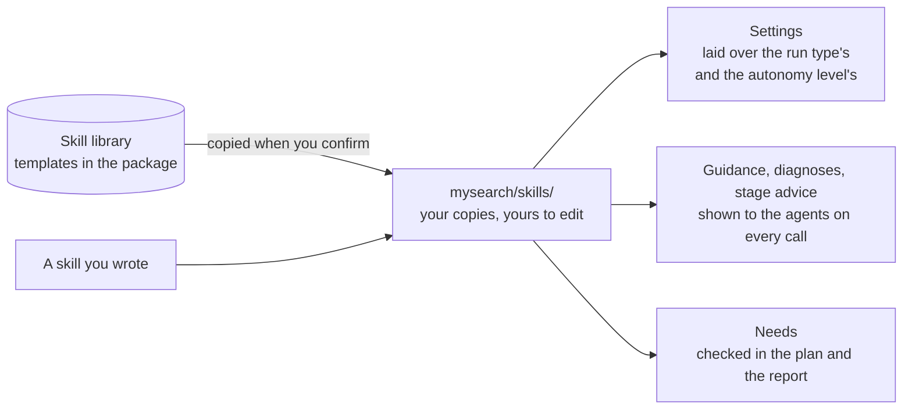

# Edit or write a skill

A skill is what evoloop knows about one kind of optimization goal: the settings that suit it, advice
for the agents, and what your evaluator has to report. Each [goal guide](which-search.md) is a skill.
This page is about changing one, combining them, and writing your own.



## The library

The skills that come with evoloop are a library of templates. The [skill library](skill-library.md)
page shows each in full; `evoloop skills` lists them and `evoloop skills --search WORDS` finds them by
what they are for.

There are twelve, listed by goal in [Which search should I run?](which-search.md). Their names follow one
pattern, *what* then *goal*, in lower case with hyphens (`model-size-frontier`, `algorithm-runtime`), which
leaves room for the next one (`model-calibration`, `algorithm-memory`).

## Your search gets its own copy

A search never runs on the library's file. When you confirm the brief, each skill it names is copied
into the search's own folder:

```
mysearch/
  skills/
    model-distillation/skill.yaml     <- the run reads this one; edit it freely
```

- Edit it to fit your problem: change the guidance, add a diagnosis from your own experience,
  remove advice that does not apply.
- The library is untouched, so another search starts from the original.
- An edit during a run is recorded. The controller notices the change at its next turn, uses the
  new text from then on, and writes a ledger entry with the file's digest before and after.
- A copy that is already there is never overwritten.

## Combining skills

Give several, as a list or separated by commas:

```yaml
run:
  skill: [model-distillation, model-size-frontier]     # a family of students, one for each size
```

- Settings are laid one over the other in the order given. Where two skills set the same thing
  differently, the later one's value stands, and the plan says which.
- Guidance, diagnoses and stage advice are joined, each part under the name of its skill.
- Needs are added together.
- A pair marked as conflicting (`settings-tuning` with any other skill, `model-size-frontier` with
  `model-efficiency`, `model-ensemble-members` with `model-efficiency`) still runs; the plan warns.
For example, `model-efficiency` picks parents from a trade-off front and `model-size-frontier` keeps the best
design per size band, so they disagree about the parent rule. With

```yaml
run:
  skill: [model-efficiency, model-size-frontier]
```

`evoloop plan` uses the later one and says so:

```
Warnings:
  - the skills model-efficiency and model-size-frontier are marked as not meant to be combined
  - both model-efficiency and model-size-frontier set strategy.mechanism; the value of model-size-frontier stands ('archive', not 'pareto')
```

Swap the order and `pareto` stands instead.


Combinations that make sense:

| Combine | For |
|---|---|
| `model-distillation` + `model-size-frontier` | a family of students across sizes |
| `model-distillation` + `model-efficiency` | the smallest student that holds the teacher's score |
| `model-finetuning` + `model-training-recipe` | adapting a pretrained model, with the recipe fully open |
| `bioinformatics-algorithm` + `algorithm-runtime` | a method that is both more accurate and faster |
| `model-ensemble-members`, then `model-distillation` | members first; then a student of their average, in a second search |

## Choosing and changing

- At setup. The questions ask for the kind of optimization and suggest one from the words of your
  goal ("distil", "faster", "pipeline", "interpretable") and from the run type.
- During a run. `evoloop set mysearch --name r1 run.skill=model-efficiency --by "Your Name"`. The
  new skill is copied in, and the ledger lists every setting that moved with it.
- With any run type and level of autonomy. Where a skill and a run type or a level of autonomy set the same
  thing, the skill's value stands,
  because it knows the problem.

## Writing your own

Start from the nearest one:

```
evoloop skills model-efficiency --copy mysearch/skills/edge-device
```

Edit `mysearch/skills/edge-device/skill.yaml`, give it a name of its own, and set
`run.skill: edge-device`. A skill is found by name in the search's `skills/` folder first, then as a
path, then in the library.

What makes a skill useful, from most to least:

1. **Diagnoses.** "If you see X, do Y" is the knowledge an expert has and a general model lacks. Write
   down the mistakes you have watched a search make.
2. **An order of attack.** What to try first, and what is rarely worth a slot.
3. **What must not change.** Conventions, constraints, things that look like improvements and are not.
4. **What to measure.** A skill that needs a figure should say so under `needs`, so that a search
   missing it is told.
5. **Settings.** Only where the task clearly calls for them; most of a skill's value is in its words.

`evoloop skills NAME` prints any skill in full, and `evoloop plan` shows what yours sets.

## Adding a skill to the library

To add a skill to the library, add its folder under `evoloop/skills/` in the repository and open a pull
request. The tests check that every library skill loads and is complete: a specific name, a title, a summary, an
objective, tags, a note on when to choose it; guidance for every role, for the writer and for the analyst; at
least four diagnoses; advice for both stages; and the guide fields (`goal`, `start`, `why`, `reading`). After
adding one, regenerate the pages built from the library (`evoloop skills --markdown > docs/skill-library.md` and
`evoloop skills --guides docs/guides`), add its guide to the navigation in `mkdocs.yml`, and add its name to the
list in `tests/test_skills.py`.

Every skill carries the same record: a name, a title, a domain, an objective, tags, a version, authors,
what it sets, what it needs, and a digest of its contents. `evoloop skills --json` prints the library
as a list of those records, which is the form a searchable website or a shared registry would hold.
That registry does not exist yet: today the library is the folder in the repository and the
[skill library](skill-library.md) page built from it.

